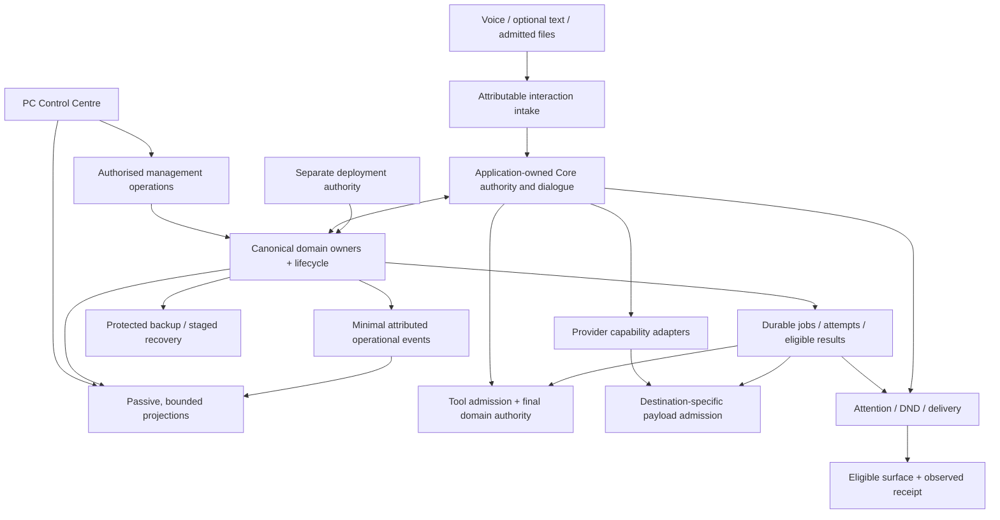
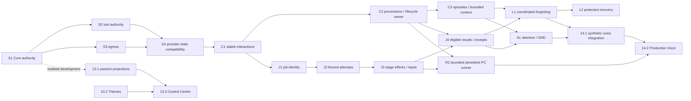

# PROJECT MAIRON — PHASE 12.4
# Consolidated Architecture Blueprint & Implementation Roadmap

**26 October 2026 · Australia/Sydney · Final Phase 12 synthesis, reviewed dependency amendment**

**Review amendment (26 October 2026):** R1's narrow persistent PC research-runner milestone no longer depends on completing the whole attention/DND system (A1) or protected historical-backup recovery (L2). It instead depends on governed existing-job admission, current eligibility and fenced recovery (S1–S4, C2, J1–J3), with historical/unknown jobs isolated and unsafe unsolicited legacy chat delivery disabled for runner-managed work. J4/A1 separately own trustworthy delivery and notification; L1/L2 still own coordinated forgetting and historical restore. No source code, test result, security gate or deployment status is changed by this document amendment.

**Evidence status:** planning only. No Mairon source inspection, implementation, test execution, account/network/device access, installation, Git operation or deployment was performed for this document. No parallel agents were used. Every implementation acceptance criterion below is **unpassed in this phase**. Approval of this blueprint would approve direction, not certify an implementation or authorise external connections.

## 1. Executive architectural decision

Evolve the existing application and Core into the single owner of Mairon's relationship, authority and state. Keep working Phase 11 domain behaviour and the research engine. Add explicit contracts at the places where identity, permissions, persistence and presentation currently diverge. There is no source-grounded reason for a wholesale rewrite, new agent framework or immediate database replacement.

The target is one continuous, voice-first relationship with bounded working context. Interactions belong to Mairon, not to a provider session or a desktop chat window. Automatic episodes and revisable topic links organise that history; source-linked projections supply only the context currently eligible for a particular purpose and destination. USER testimony, external claims, Mairon's opinions, commitments and operational results retain distinct owners and evidence rules.

Adopt a canonical identity/revision/lifecycle layer over the existing stores first. Existing SQLite and JSON stores can remain physical repositories or projections behind their accountable owners. Legacy records must keep their uncertainty; similar text is not proof of common identity or causation. Unrestricted legacy writers cannot bypass the new layer once a domain migrates.

The recommended delivery order is:

1. **A bounded pre-Phase-13 security/stabilisation wave, S1–S4:** typed Core authority and safe failure; executor admission; independent cloud export admission; provider-state compatibility. These address confirmed boundary gaps before broader capabilities use them.
2. **Phase 13 remains Themes + bounded Control Centre foundation, 13.1–13.3.** Passive projection and shell development can proceed alongside S1–S4 using isolated fixtures and admitted local observations. Release the integrated optional text path only after its S1–S4 checks. No full Memory Manager, email integration, Pi rollout or monitoring platform belongs here.
3. **Post-13 foundations:** canonical interactions, provenance/lifecycle, bounded continuity, job ownership/fencing, eligible results, attention, coordinated forgetting and protected recovery. A narrow persistent PC research runner may be built after governed J1–J3 work, independently of full J4/A1 delivery and L2 historical restore. Its output remains held from unsafe unsolicited presentation until the eligible delivery contract is implemented; no always-on or completed-notification promise follows from storage alone.
4. **Phase 14 remains Production Voice, 14.1–14.2.** First prove the contracts with text/synthetic fixtures; then validate real capture, transcription, speakers, interruption, playback privacy and latency on an authorised host. Pi deployment is a separate gated branch.
5. **Independent later slices:** the full Memory Manager, secure attachments, dependable reminders/watches, usage accounting, dedicated email and remote/Pi deployment. Their order follows their dependencies and immediate value, not completion of every console placeholder.

Generated-public acceptance remains **shadow-only**. **Technical Gate C is not authorised. RG-1–RG-9 remain open; G1–G5 remain ungraduated.** Completing one scoped milestone can supply evidence for part of a gate; it cannot silently close the whole gate.

## 2. Current source-grounded baseline and evidence limitations

### 2.1 Authority and reference convention

The present request governs this task. Historical “next task,” stop, permission and commissioning instructions inside the reports are context, not new instructions. Phase 12.3B controls where it amends 12.3A, particularly continuous interaction, relationship-owned results, preserved backups, the Control Centre and phase boundaries.

| Key | Supplied evidence | Use here |
|---|---|---|
| A | [12.3A decision register](PHASE12_3A_ARCHITECTURE_DECISION_REGISTER.md) | ADR-01–12, preservation rules, V01–V12 and G1–G5 evidence requirements, as amended. |
| B | [12.3B controlling amendment](PHASE12_3B_ARCHITECTURE_DECISIONS_AND_CONTROL_CENTRE.md) | Accepted directions, ADR-13–16, BC-01–12, RG-1–9, backup and PC/Pi semantics. |
| 1B | [Authority/provider source evidence](PHASE12_3C1B_SOURCE_EVIDENCE.md) | Exact dispatch, authority, conversion, export and state seams; T1–T9. |
| 2A | [Memory/continuity/forgetting validation](PHASE12_3C2A_MEMORY_CONTINUITY_FORGETTING_VALIDATION.md) | Store identities, lineage, recovery, deletion and concurrency; T1–T12. |
| 2B | [Durable jobs/recovery validation](PHASE12_3C2B_DURABLE_JOBS_RECOVERY_VALIDATION.md) | Admission, claims, stage recovery, repair, delivery; J01–J16. |
| 3 | [Control Centre/management validation](PHASE12_3C3_CONTROL_CENTRE_MANAGEMENT_VALIDATION.md) | UI lifecycle, passive-read hazards, actual diagnostics and management; CC01–CC12. |

References such as **1B:T5**, **2A:T5**, **2B:J09** and **3:CC10** are deliberately namespaced. They are specifications, not pass records. Source paths and line numbers reproduced below are October 19 snapshot references from these reports, not inspected current-tree locations. Section references identify the supporting report without copying its research discussion.

### 2.2 What is known, proposed and still unknown

| Evidence class | Meaning in this blueprint |
|---|---|
| **Accepted requirement** | Direction confirmed in B or the present request: owned identity, continuous relationship, preserved backups, one writer, console orientation and phase boundaries. Acceptance is not implementation evidence. |
| **Snapshot fact** | Static structure directly reported by 1B/2A/2B/3. Conditional failure paths are reasoned risks, not reproduced runtime failures, exploits or disclosures. |
| **Proposed architecture** | The contracts, logical owners, migrations and milestones in §§3–13. They require implementation and review. Names describe responsibilities, not selected classes or services. |
| **Current-tree unknown** | The repository location, branch, commit, local changes, installed SDKs, configuration and deployed state have not been checked here. Snapshot equivalence is unproved. |
| **Implementation required** | A source gap must be confirmed against the narrow current delta, then fixed or shown already fixed with relevant evidence. |
| **Unpassed gate/test** | Every proposed case in this document and the four C packets remains unexecuted here. Historical results do not become current results. |

The source evidence concerns the selectively allowlisted **Mairon-Phase12-Audit-20261019.zip** extraction. October 19 identifies the archive/audit, not a verified commit date. Report 3 records 447 manifest entries and **189 omissions**. The reported manifest SHA-256 is `4c12532837598f4a6694c30c38d24feed4023101d046cdd86ce626b43e531ca6`. Selected-file hash matches establish those files' consistency with that manifest, not completeness, current-tree equivalence or runtime reliability. No omitted component is declared nonexistent merely because it was outside the packets.

### 2.3 Baseline that determines the roadmap

| Snapshot fact and source | Engineering consequence |
|---|---|
| APP/Core provide deterministic lanes and contracts; local provider retains substantial specialised orchestration. Cloud has a smaller pipeline and a different return shape. Core failure can continue into provider work. Legacy conversion loses structured required claims/general metadata and flattens evidence. **1B §§2/5.** | Carry typed authority/evidence alongside model instructions; declare provider obligations; stop affected continuation on missing authority. Preserve existing local checks during migration. |
| Global registry accepts registered names without caller/turn-pool authority; schemas are declarations, not general runtime validation. Unknown names already fail. Calendar proposals remain separately guarded. **1B §3.** | Enforce trusted scope plus final domain checks; preserve unknown-name failure and valid approvals. Do not infer arbitrary execution or an observed exploit. |
| Traced cloud initial/follow-up requests lack independent field-level admission; whole tool results are serialised. Cloud state can contain a Python list where a response ID is forwarded. **1B §4.** | Separate execution from export; separate context from continuation handles; check every request, including approval and tool-output follow-up. |
| CHAT and JOUR have different identities and non-atomic cross-store recording. Restored chat rebuild is unbounded; preference/opinion recovery can write from surviving journal history. **2A §§2–5.** | Stable interaction identity and reconciled projections precede continuity guarantees and functional forgetting. Existing bounded lexical recall is useful but not an episode summariser. |
| Memory/opinion/social/spoiler stores lack complete revisions and lineage; JSON replacement does not provide writer conflict control. Local derivative writes can precede final application recording. **2A §§4–5.** | Govern every migrated read/write/recovery seam, including titles and callbacks; do not solve forgetting by deleting one row or index. |
| Research already has evidence, checkpoints, synthesis, verification, conditional owner writes and a bounded repair design. Topic-only admission, expiry/generation gaps, stale administrative writes and repair rearming remain. **2B §§2–4.** | Keep the engine; extend admission, claim, operation and lifecycle contracts before persistent service or broader effects. |
| Application delivery completion precedes rendering; current-chat marker is not a global result receipt. Desktop close destroys the root and has no retained research-host path. **2B §5; 3 §2.** | Separate result availability, surface receipt, playback and acknowledgement; validate runner lifetime independently. |
| Themes/intake are placeholders. Some getters initialise/migrate/recover; Agent status can create credentials/start a process; Gmail reads can invoke credential setup. Diagnostics accept private free-form strings. **3 §§2–5/7.** | Build passive readers and typed diagnostics first. Do not bootstrap the assistant, call OAuth, poll delivery or parse files merely to fill a card. |

The historical **302/302, 56/56 and 51/51** results and **7.82-second mean over 28 turns** are retained as reported in A. Their exact configurations and missing witnesses remain limitations. They are neither fresh passes nor tail-latency, production-voice or Pi benchmarks. Preserve the historical assertions and benchmark meaning; record future results separately.

### 2.4 Narrow baseline before implementation

S1 starts with a bounded current-branch baseline, not another audit. In the separately commissioned repository: verify the intended checkout, repository/account/remote and branch; record commit identity and relevant uncommitted changes; read applicable repository instructions; identify the existing test commands. Compare only the files/symbols touched by that milestone against the reported snapshot, following a direct caller/callee only when required to establish the changed boundary. No private stores, credentials, broad history scan or re-investigation of competitors is needed.

Classify each cited concern as unchanged, already corrected with evidence, or changed and needing a local adaptation. Stop only the affected slice for an incompatible delta; continue independent work. Record the delta and preservation evidence in that milestone's review/commit material. Do not modify an unrelated user change, transplant October 19 line numbers blindly, or assume the current projectless folder is Mairon's repository. §13 fixes the first package's exact starting set.

## 3. Target architecture and responsibility/authority boundaries

These are logical boundaries. Several may remain in the same process and use current storage. Nothing below selects a queue product, graph/vector database, remote transport, supervisor, backup vendor or Pi hardware.

| Boundary | Accountable responsibility | Explicit limit and dependency |
|---|---|---|
| **1. Core and providers** | Application resolves turn purpose, evidence authority, context eligibility, permitted actions and required checks. Adapter declares supported generation/tool/state capabilities and reports typed outcomes. | Keep provider-local implementations behind conformance adapters initially. A provider cannot waive an obligation it cannot implement; select an authorised capable route or return a precise limitation. Provider neutrality does not mean identical quality. |
| **2. Execution and egress** | Trusted application scope admits concrete tool name/arguments/target; domain executor validates the final effect and approval. Independent egress policy admits each outbound field for a destination and purpose. | Tool advertisement, a UI button, familiar sender, voice match, read access or prompt instruction is not sufficient authority. No implicit cloud fallback or read→remember/export/act widening. |
| **3. Interaction/context** | Canonical relationship owner records stable events; episode/topic links are revisable views. Context builder selects eligible source versions within a finite budget. | A chat is an optional view. Provider handles and summaries are disposable derivatives, not history or original evidence. Reconstruction never replays old actions. |
| **4. Memory/identity/knowledge** | Distinct owners govern USER memories/preferences, external claims, Mairon opinions/commitments and dated advice/outcomes. Common identity and lineage connect them. | USER agreement cannot manufacture Mairon's stance; assistant prose is not public evidence; an outcome does not prove advice caused it. Consolidation stays proposal-only. |
| **5. Lifecycle/recovery** | One authority commits corrections, exclusions and deliberate recoveries; readers, workers and output commits consume its current revision. Protected backup admission reconciles newer decisions. | Exclusion is immediate at authoritative commit; cleanup can follow. No topic ban by default, backup purge, old-grant resurrection or falsely safe restore with missing lifecycle history. |
| **6. Durable work** | Canonical job owns accepted purpose/scope, attempts, checkpoints, cancellation, effect uncertainty and result versions. Workers execute bounded stages. | Topic similarity cannot merge goals; worker ownership cannot outlive its valid claim; verification does not override current lifecycle eligibility. |
| **7. Observation/attention** | Source adapters report observations and coverage; due-time/watch owners admit work. One attention owner applies DND, relevance, privacy, expiry and routing. | Source receipt is not work admission or permission to speak. Reachability is not user presence. No DND override without a configured supported exception. |
| **8. Read/management** | Versioned passive projections expose permitted fields. Typed mutations validate actor, capability, target, expected revision, operation identity and authority generation at the owner. | Read, edit, recover, execute, export and deploy are different capabilities. A lost reply is unknown until reconciled; a draft is not saved. |
| **9. Control Centre** | Management client with Overview, inspectors, diagnostics and explicit actions. Optional text submits to the same application/Core. | It is neither a second orchestrator nor a writable database replica. Navigation does not submit prompts, open/reset chats, claim delivery or start services. |
| **10. Diagnostics/usage/security** | Bounded producers emit minimal typed observations and attempt receipts; aggregator reconciles identities, coverage and costs. | Raw logs are not the event schema. Missing values are not zero; configured model, measured model and provider-attested model are distinguishable. |
| **11. Intake/email** | Intake authority admits source identity, bounded validation/extraction and retention. Email adds mailbox identity, sender assessment and independently admitted tasks. | Content remains untrusted even from recognised senders. Preview is not parsing, memory promotion or execution; outbound actions need separate authority and effect reconciliation. |
| **12. PC/Pi** | PC is sole canonical host first; future Pi becomes the designated writer through controlled transfer. PC retains development, management and eligible heavy compute. | One writer per domain; no silent takeover or independently edited database copies. Deployment authority is separate from administration. |
| **13. Voice/privacy** | Capture, transcript revisions, attribution and playback adapt shared interaction/result contracts. Audience policy gates sensitive speech. | Unknown/third-party speech is not Oliver's testimony or approval. Speaker confidence is not privileged authentication. Always-on availability is not indiscriminate recording. |

## 4. Reusable components versus required changes

| Existing component family | Retain substantially | Required adaptation / genuinely new responsibility |
|---|---|---|
| `src/application_service.py`, `src/core/orchestrator.py`, router, answer contracts | Core deterministic routes, workflow selection, final sanitisation, explicit approval handling. | Typed authority/result envelope and Core-failure boundary; staged application ownership, without extracting the entire local provider. |
| `src/ai/ollama_provider.py`, `src/ai/openai_provider.py`, provider factory | Existing clients and specialised local dialogue/research checks. | Capability declarations, explicit three-/four-field result adaptation, context/handle separation and independent request admission. Keep enforcing checks enforcing and shadow observers observational. |
| Registry, action manager, calendar proposal guard, file/domain/Agent guards | Existing narrow operations, calendar approvals, approved roots/sensitive-path restrictions, typed localhost Agent boundary. | Trusted call admission at generic and bypass paths; runtime schema/type checks; approval binding and final-executor evidence. No generic shell expansion. |
| CHAT/JOUR, continuity/context helpers | Stored dialogue, roles where evidenced, timing, bounded lexical recall, current Core referents. | Canonical event/operation IDs, projection receipts and legacy mapping; automatic episodes, topic links and bounded source manifests. No immediate store replacement. |
| Memory/preference/opinion/social/spoiler stores; identity instructions; opinion knowledge checks | Preference capture constraints, opinion revision/ownership, sensitivity/cooldowns, spoiler ceilings and USER/public distinctions. | Governed revisions, validity and source lineage; conflict-safe writes, recoveries and cleanup. Add explicit commitment/advice-outcome records only where needed, without invented legacy backfill. |
| Research jobs/worker/delivery, final synthesis/verifier | Evidence filtering, quality decisions, checkpoints, source limits, verified text, stage yields and one logical repair policy. | Admission identity, attempt/claim fencing, effect receipts, migration/activation separation, result eligibility and surface/disposition records. Do not rebuild synthesis. |
| `src/desktop_app.py`, `src/mairon_theme.py`, existing widgets | Toolkit/widgets/tokens where practical, optional text and explicit approval surfaces. | Module navigation, real theme editing/persistence, passive projections and typed diagnostic display. A framework replacement has no demonstrated need. |
| Response timer and persisted timing/research fields | Existing measurements with their actual definitions. | Provenance/freshness/coverage envelope now; per-attempt tokens/API/cost and wider security/host telemetry later. Do not scrape debug text. |
| Gmail/web/file/alarms/routine adapters | Read-only Gmail scope, bounded public reads, approved file-opening rules, existing alarm/routine records. | Separate secure attachment pipeline; later mailbox and due-event/watch owners. Stored alarms do not prove firing; file opening does not prove ingestion. |
| Current voice callbacks and desktop Agent | Existing wiring and narrow device boundary as compatibility anchors. | Validate voice internals when Phase 14 touches them; add attribution/privacy/receipt handling. Separate runner and later authenticated management/authority transfer are new responsibilities. |

A new logical owner need not be a new service. Add a physical index, queue, database or process only when a milestone demonstrates a specific integrity, supervision, performance or isolation need that current mechanisms cannot satisfy.

## 5. Security, privacy, memory and job lifecycle contracts

### 5.1 Common authority and mutation envelope

Use a trusted envelope carrying operation identity, initiator/actor and device attribution, purpose, capability/scope revision, concrete target/arguments, authority generation, current lifecycle reference and any approval binding. Keep **epistemic authority** (what a claim can assert) distinct from **execution/administrative authority** (what may be done). Neither a Core authority label nor model-generated metadata authenticates a caller.

Mutations additionally carry expected object/configuration revision and a payload identity. Identical operation retry returns the same known outcome; changed payload under the same ID conflicts. Commit the domain update and recoverable operation outcome together, or use a durable intent plus idempotent projection receipts where stores cannot share a transaction. Return committed, rejected, conflict, pending or outcome-unknown explicitly. Never silently last-write-wins privacy, memory, permission or opinion changes.

Approval remains bound to the reviewed effect, arguments, destination and permitted data. Recheck expiry/revocation and changed scope at execution. Do not turn routine already-authorised work into repeated confirmation prompts. Conversely, old provider markers, restored dialogue or familiar voices do not renew grants.

### 5.2 Core failure, tool admission and export

`prepare_turn` is not a pure planner: reported file/browser/launch/email paths can act during preparation, and preference capture occurs before it. Check authority before those effect-bearing calls. On failure, deny new authority-dependent provider/tool/export work; preserve an already independently safe deterministic response where its existing contract supports it. If a workflow may already have acted, record/report uncertainty and reconcile; do not retry through another provider as though nothing happened.

At dispatch, intersect the registered capability with trusted route/task permissions, the current effective tool pool, argument schema/types and concrete approval where required. Validate no-argument tools too. Malformed input must not turn into `{}` and accidentally invoke a no-argument tool. Preserve unknown-name failure, local relative-date grounding and pending calendar proposals. Forced reads and Core workflow calls need equivalent admission, not only model-returned calls.

At every outbound request, build an admitted projection **before serialisation**. Evaluate user input, contract evidence, continuity, restored history, tool results, nested metadata and diagnostics separately by purpose/data class/destination. Denied or unclassified fields cannot enter the client payload; authorised public data remains usable. Approval to use a cloud route is not blanket field consent. A continuation handle is reusable only with compatible provider/model/account scope, context lineage, grant and lifecycle state; otherwise rebuild eligible context or return a supported limitation. No local mechanism promises erasure of provider-retained information already exported.

Keep the original typed evidence/lineage with the typed contract; flattened runtime evidence strings are not equivalent. Legacy text is a compatibility representation, not a way to fabricate missing mandatory authority. Reject missing obligations at the route boundary rather than silently treating unknown fields as safe defaults.

### 5.3 Interaction, identity and bounded context

Allocate stable relationship-scoped event IDs before dependent writes. Record event kind, actor/unknown speaker, modality/device, event and receipt times, content revision, source spans, sensitivity/retention and current eligibility. USER, assistant, research/tool result and system events are separate kinds. A research marker stored in a legacy USER column must not become USER testimony.

Map legacy records by namespaced store/table/key identity. Preserve original timestamp representation and uncertainty. Do not join journal/chat integer IDs or identical prose as if identity were established. Canonical acceptance records projection status so interruption between JOUR/CHAT writes is repairable without duplicating the interaction. A real repeated sentence receives a new event; retry of the same accepted operation does not.

Episodes organise activity; many-to-many topic links may be provisional or corrected. They never rewrite original source records or require manual chat creation. Bounded context manifests identify selected source versions, omitted coverage, budget, unresolved references, decisions, spoiler limits and current task/approval references. Reserve an output budget. Summaries retain support and limitations; they cannot cite themselves as original evidence. Missing/corrupt checkpoints produce a gap or bounded reconstruction, not invented familiarity. Approval references must resolve to current authority, not cached prose.

### 5.4 Memory, revisions and coordinated forgetting

| Record class | Minimum rule |
|---|---|
| USER memory/preference | Explicit/inferred status, actor, temporal/situational scope, source revisions and corrections. Old explicit testimony cannot automatically defeat a newer valid contextual correction. |
| External knowledge | Source/claim identity and version, support/conflict, access/read state, freshness and spoiler eligibility. A governed claim may still be uncertain. |
| Mairon opinion | Owned stance, predecessor, basis and reason for revision. USER disagreement alone is not a revision instruction. Factual reasons require independent evidence. |
| Commitment and advice/outcome | Separate commitment rule from provisional taste; link dated advice and conditions to independently evidenced outcomes. Do not infer satisfaction, compliance or causation from silence. |
| Derivative | Source IDs/spans and revisions, method/version, coverage gaps, validity and lifecycle state. Selected/supplied/cited are distinct from unknown model influence. |

The lifecycle owner commits correction/deletion/recovery and advances a monotonic eligibility revision. Enforce the decision at context construction, direct writes, journal recovery, callback/title generation, checkpoint/result commit and actual output/delivery. Serialize or fence the final check-and-commit boundary so an L1 check cannot authorise a write after L2 deletion. New record IDs do not cleanse old lineage.

Forgetting resolves a concrete scope, commits immediate live exclusion, then reconciles source copies, memories, opinions within scope, social/spoiler associations, summaries/titles, indexes/caches, provider handles and dependent jobs/results. Rebuild shared derivatives only from demonstrably eligible support; otherwise quarantine or disclose a coarser exclusion. Preserve unrelated work. Lost spoiler progress becomes **unknown**, not permission to reveal spoilers. Direct “forget our discussions” can be confirmed verbally when scope is clear; clarify consequential ambiguity without requiring desktop record selection.

Receipt fields distinguish exclusion confirmed/pending, cleanup complete/pending, unknown legacy coverage, preserved backups and external/retraction limits. Delete-chat, correct, stop-use, forget, suppress unsolicited mentions and recover are distinct operations. Forgetting does not create suppression. Fresh discussion or independent evidence about the same subject is allowed with new provenance, without historical familiarity claims. Until coordinated forgetting is implemented, legacy chat/memory delete actions must use accurate narrow labels and cannot promise global forgetting.

### 5.5 State, backups, caches and recovery

| Category | Role | Eligibility and recovery rule |
|---|---|---|
| Ordinary live state | Canonical current records and governed history. | Subject to current lifecycle and scoped access; one writer per domain. |
| Noncanonical cache/projection | Disposable read/context/index or device view. | Cannot originate canonical edits or bypass exclusions. Withhold private cached content when current eligibility cannot be established; stale non-sensitive health may remain labelled. |
| Historical backup | Protected recoverable historical copy. | Preserved through live forgetting; no routine search, recall, embedding or consolidation. Do not rewrite it or destroy its recovery keys in the name of forgetting. Retention/rotation is a separate policy. |
| Protected lifecycle ledger | Minimal deletion/correction/recovery metadata and completeness watermark. | Independently recoverable recent state, integrity/access controlled. Avoid deleted text, revealing labels and reversible fingerprints by default. A valid old ledger is still too old. |
| Provider-retained external information | Previously exported content/remote continuation state. | Local exclusion can prevent reuse and future export, not certify remote deletion. Record the limit honestly. |

Restore stages data outside live stores **before ordinary initialisers can migrate or activate it**. Verify compatibility and latest trustworthy lifecycle completeness; apply newer exclusions/corrections/recoveries; rebuild eligible projections; invalidate old handles/grants; reconcile jobs/effects; activate one writer generation. Missing/corrupt/stale ledger keeps affected content isolated. Explicit subset recovery appends a new decision with original and recovery dates; preview alone re-admits nothing. Never revive historical credentials, approvals, pending emails or tasks. Rollback must preserve later exclusions/revocations; use compatible forward repair when a downgrade cannot do so.

### 5.6 Durable work, result and attention semantics

Persist job ID, admission-operation ID, relationship/task/initiating interaction, accepted purpose/scope revision, source manifest, budgets and capability needs. Topic is an association, never the idempotency key. An offered job requires its actual approval; an explicit bounded request remains admission. A changed brief invalidates incompatible authority/checkpoints.

Each attempt/stage operation carries unique claim generation, owner, expiry, authority generation, expected job/checkpoint revision, cancellation and lifecycle revision. Check them in the authoritative conditional write, renewal and surface dispatch. Expired ownership cannot renew itself without valid reacquisition; a stale exception must not fail the replacement worker's job or kill the runner. Administrative updates use the same revision rules.

Record external dispatch/receipt/outcome separately from computation status. Reconcile known receipts after timeout; leave unreconciled effects unknown. Retry only a permitted replay-safe operation within its budget, acknowledging possible duplicate use/cost. Do not promise exactly-once external execution. Persist one logical repair invocation/outcome so empty, unchanged, failed or uncertain repair cannot be rearmed by compatibility initialisation. Preserve fresh verification after repair and the existing review-required outcomes.

Result identity/version binds the exact draft, verification and source/scope revisions. Saved/verified is not necessarily eligible. Available, offered, surfaced, playback requested/started/interrupted/completed/unknown, acknowledged, dismissed and deferred are independent facts. A chat insert is not rendering; playback is not human acknowledgement; stopping speech is not automatically job cancellation. The surface reports only what it observed. Failed, cancelled, waiting and uncertain outcomes remain retrievable with truthful reasons.

Attention checks current result/lifecycle, DND, audience, spoiler limits, expiry and destination before dispatch. A full report stays attached to its task, not injected into an unrelated current topic. Even a neutral notice requires permission to reveal the task's existence. Reconnection coalesces eligible offers rather than replaying a flood. Direct questions can be answered within DND without releasing the queue. Unknown presence remains unknown.

### 5.7 Passive reads, diagnostics and intake

Passive projections return domain/object identity, known revisions/generation, producer/source, original observation time, query time, coverage/window/limits, freshness and unavailable reasons. No schema creation/migration, recovery/promotion, model call, file parsing, OAuth/secret creation, service launch, job claim/renewal/retry/delivery or mailbox mutation is allowed. Missing/corrupt/old schemas remain unavailable rather than auto-repaired. Use bounded queries or admitted precomputed projections; a result limit alone does not bound a full-store scan.

Routine diagnostics use typed allowlisted fields and safe error categories, excluding private titles/topics, prompts/answers, mail, paths, credentials, raw audio and raw exceptions. Detail inspection and export have separate permissions. Keep attempt counts, worker claims, API requests, quota units, tokens and charges distinct. Later costs carry currency, dated rate/source and estimate/actual status; reconcile replacement actuals without double charging. Partial counts show missing coverage. Narrow local debug token fields are not an all-route ledger.

Intake separates selection, admission, validation/quarantine, extraction, indexing and optional promotion. Bound content type, bytes, expansion, pages, memory and time; isolate parsers from credentials/tools/network. Preserve source identity, corrections and channel provenance. Mail adds independent sender assessment and task admission; familiar From text cannot grant authority. Preview is inert and cannot load tracking resources or release attachments. Outbound approval binds recipients, content, attachments and operation identity; acceptance, delivery and reading remain separate, and uncertain sends are reconciled before retry.

## 6. Control Centre architecture and Phase 13 boundary

Use five navigation groups plus a compact Overview. They contain all requested destinations without eleven oversized top-level screens. Preserve existing widgets/tokens where useful; detailed visual design and code are outside this phase.

| Navigation group / destination | Phase 13 | Later activation condition |
|---|---|---|
| **Overview** | Default landing view: evidenced build/source identity, PC authority designation, configured runtime/provider presence, pending-approval kind, latest recorded observation and current limitations. | Actual service/resource health only when a validated producer exists. No invented uptime or Pi availability. |
| **Work — Jobs & Automations; Files & Intake** | Small saved-research diagnostic summary through passive projection; Files explains unavailable intake. Drop area inactive. | Job controls require J1–J4/C2; automations O1/O2; file processing I1. |
| **Personal state — Memory Explorer/Inspector; Knowledge & Opinions** | Discoverable destinations with honest future state. Optional metadata-only read slice only if independently safe; not required for completion. | M1 after lineage, revisions, forgetting and recovery. Keep USER data, Mairon stance and external claims visibly distinct. |
| **Operations — Diagnostics; Usage & Costs; Devices & Connections** | Last response and bounded recorded timing/research diagnostics. Usage/cost/resource/Pi values are unavailable/not instrumented unless evidenced. Last Agent observation retains its original age. | U1 for accounting; R1 for service observations; P1/P2 for authenticated devices/Pi. A refresh never becomes a probe or pairing action. |
| **Communications — Email Centre; optional Chat / Activity History** | Email capability explanation only. Smaller optional text interaction with existing deliberate approvals; history inspection separated from active chat restore. | E1/E2 for dedicated mailbox; C1/C3 for canonical history. Result delivery remains an explicit adapter, separate from passive navigation. |
| **Configuration — Settings & Themes** | Functional presets/custom themes, colour editing, preview, save/reset and persistence. Broader settings read-only/unavailable. | Authorised domain settings after C2 and each relevant gate; deploy/restart/credentials remain separate privileges. |

Phase 13 must deliver useful theme presets and custom named themes; editable **HEX and RGB** values with validation and consistent conversion; saved selection/custom values; reliable restart/reload persistence; explicit save failure and safe fallback. Include live preview/application without restart as the preferred acceptance target; if existing widget constraints prevent full live application, document the exact affected surfaces and obtain an explicit disposition rather than silently dropping the requirement. Preview is temporary until saved. Declare theme settings device-local or canonical; recommended initial scope is device-local visual preferences, with any Mairon-wide preference routed through the PC owner. Never store two independently authoritative selections.

Three compact diagnostic projections suffice: **Overview**, **Last response**, and **Recorded diagnostics** using bounded timing and/or saved research. At least some configuration/operating or clearly historical recorded evidence must be genuine. A wholly invented or entirely placeholder dashboard fails. An honestly empty store need not be populated by triggering work. Static/sanitised snapshot data must be labelled historical, with live validation still outstanding.

Label response timing **active response-ready processing**: it excludes capture/transcription, approval waits, later persistence/title generation, render queues and playback. Exclude research delivery's placeholder `0.0` from measured latency; it does not prove zero time or cost. Show sample count/window and measured-path limitations. `attempt_count` means worker claims; `delivered` means legacy delivery completion; paused+auto-resume differs from review pause. Configured provider presence is not health.

**Parallel development answer:** yes. 13.1–13.3 can develop with published snapshots/fixtures, sentinel application state and no active bootstrap. Theme/navigation work does not need memory deletion, a service supervisor, production voice or Pi. Integrated release requires passive-read/privacy evidence and the S1–S4 regressions for the reused interaction route. Current desktop closure limitations must be disclosed; Phase 13 is not required to implement R1 merely to finish the shell.

## 7. Voice/Pi target integration architecture

### 7.1 Production voice

Voice is an adapter into the same relationship and authority contracts, not a separate assistant. Keep raw audio, partial recognition, final transcript, corrected transcript, speaker attribution and derived memory distinct. No routine raw-audio archive is assumed; capture/retention policy must be resolved before real capture. Unknown speakers and guests cannot inherit Oliver's approvals or durable memories. Capture indicators and an effective stop control are required.

Text/synthetic fixtures can prove event identity, attribution uncertainty, correction propagation, bounded rollover, approval binding, DND, audience-based blocking, result receipts and separate playback/cancellation semantics. They can also test interruption state transitions, transcript retention policy and fake provider switching. They cannot establish microphone quality, speaker error rates, acoustic privacy, speech naturalness, real interruption cleanup or end-to-end latency.

Phase 14 real evidence must cover those gaps on the actual authorised host, with configured privacy rules and finite latency/quality targets set before evaluation. Measure capture-to-transcript, first audible response and complete response separately from existing processing timing. Test unknown/third-party speakers, ambiguous transcripts, competing audio, interruption, stale/deleted queued speech, device loss and recovery. Use an authorised capable route or a clear limitation; never silently export audio/transcripts or fall back to cloud. No requirement here selects a speech model or hardware.

### 7.2 PC-local first; Pi only after its own cutover gate

| Situation | Required target behaviour |
|---|---|
| PC canonical, console closed | State stays PC-owned. Work continues only if the separately validated runner is available; otherwise report waiting/missed work. Current desktop source alone does not provide that runner. |
| Pi canonical and available, PC off | Only measured, admitted Pi-eligible coordination/voice/reminder work continues. Heavy PC stages wait for PC capability. |
| Pi unavailable or network partitioned | No automatic PC takeover or canonical offline writes. Keep safe local drafts/receipts with unknown outcomes; withhold private cache use without current eligibility. |
| Reconnect | Revalidate identity, grants, authority generation, lifecycle and operation/effect receipts before resuming. Old-generation workers cannot commit. |
| Cutover or reversal | Pause/checkpoint; preserve content snapshot plus current protected ledger; verify compatibility; fence old writer; activate one new generation; rebind clients and reconcile work/delivery. No period of two authoritative writers. |
| Release/restart | Separate deployment authority and identified software/schema/management/ledger versions. Validate migration, health and deletion-aware rollback; never hide restart inside a settings save. |

Actual hardware/network evidence is required for Pi storage integrity/recovery, memory/CPU/thermal capacity, audio devices, service startup, power interruption, clock behaviour, network partitions/reconnect and heavy-work handoff. Wake/shutdown feasibility also needs device evidence if later requested. Select hardware, protected transport, packaging and backup custody only when the corresponding bounded milestone needs them. A LAN connection or a configurable localhost Agent URL is not remote trust. Phase 14 may complete on PC with explicit availability limits; it does not imply Pi deployment.

## 8. Dependency and critical-path diagrams

Solid arrows below are hard dependencies for enabling the downstream capability. A dashed arrow permits development against a stable contract/fixture before integration; it is not permission to bypass release evidence. IDs refer to §9.

| Required chain | Hard dependency / integration order | Work that can proceed independently |
|---|---|---|
| **A. Core → tools/egress → provider state** | S1 supplies trusted authority; S2 and S3 enforce effect/export boundaries; S4 consumes them for safe reconstructed/continued provider context. No route parity inferred from prompt text. | S2/S3 implementation can use S1's fixed contract in parallel. State adapter fixture design can start early; unsafe cloud continuation stays disabled until its guards pass. |
| **B. Interactions → provenance/lifecycle → forgetting → Memory Manager** | C1 → C2; C3 and J4 integrate current eligibility; L1 → L2 → M1. Functional delete/recover controls wait for authoritative receipts and anti-resurrection evidence. | Passive metadata view and theme work can precede C1. C3 does not require the full Memory Manager. |
| **C. Job identity → attempts → eligible results → delivery/attention → voice** | J1 → J2 → J3 permits **R1's narrowly scoped independent research hosting** with C2 and S1–S4 caller coverage; separately J3 → J4 → A1 enables eligible result presentation/attention. Production Voice 14.2 consumes the runner **and** J4/A1/14.1. L2 is not a runner prerequisite, but historical restores must remain disabled without L2. | Job fencing/recovery can develop alongside continuity using a fake lifecycle owner. R1 may persist approved research and retain its result without sending unsolicited output; J4/A1 supply safe presentation. No runner claims uninterrupted service when the PC is off. |
| **D. Passive projections → console → authorised controls** | 13.1 + 13.2 → 13.3. General settings use C2 mutation receipts; memory controls require M1; job controls require J1–J4; each invokes its domain gate. | Themes is a deliberately narrow presentation mutation; it does not wait for general settings, remote administration or full personal-state migration. |
| **E. PC owner → protected recovery → authenticated management → Pi** | C2/L1/L2 and R1 → P1 → P2. Hardware/network and writer-transfer evidence must pass before cutover. | PC-local contracts, recovery fixtures and Phase 13 need no Pi purchase or transport selection. Phase 14 may finish before P1/P2. |
| **F. Intake authority → file/email processing → bounded automation/outbound** | S1–S4 + C1/C2/L1 → I1; I1 + governed jobs/attention → E1; E1 + J3 effect reconciliation → E2. New watch sources similarly need source admission and O2 evidence. | Inert placeholders and synthetic malicious-content cases can precede processing. Dedicated inbound email and outbound sending are separate releases; neither is required for Phase 13/14. |

Recommended scheduling after Phase 13: establish C1/C2 and J1–J3 through bounded compatible workstreams; once those and scoped S1–S4 coverage are validated, **R1 may follow early** as a PC-only runner for currently eligible, approved research with safe result holding. In parallel, complete C3 and J4, then L1/L2 and A1 as their dependencies allow. **No unsolicited presentation, DND assurance, historical restore or general unattended effects are enabled merely by R1.** 14.2 still requires both R1 and the J4/A1 voice-delivery chain. M1, O1/O2, I1, E1/E2, U1 and P1/P2 are later value slices where dependencies permit. This is an engineering ordering, not a new phase.

## 9. Ordered, independently deliverable engineering milestones

### 9.1 Common milestone contract

Each card below is a separately reviewable implementation package. **All are planned, not executed.** Dependencies are hard release conditions unless explicitly labelled development-only. A milestone exits only when its stated cases pass on its recorded implementation revision, prohibited-call/write counts are zero where specified, expected positive paths remain usable, and failures/limitations have a review disposition. No aggregate score can hide an authority, privacy, ownership or lifecycle violation.

**Preservation P0 applies to every card:** existing deterministic Core responses; enforcing verification and domain guards; calendar/research approvals; USER/public/opinion separation; independent stance and explicit revision; spoiler protection; bounded research collection/synthesis/repair; final sanitisation; existing supported text behaviour. Generated-public common acceptance remains shadow-only, and bounded publication keeps its existing scope. No Gate C or G1–G5 graduation is included.

**State rule M0 applies wherever state changes:** additive, versioned migration first; preserve original legacy IDs/content and uncertainty; explicit migration/activation separate from reads; interruption-safe operation receipts; old writers fenced before switching authority; preserve later lifecycle/revocation decisions on rollback. Take a separately authorised protected pre-migration snapshot and reconcile the current ledger before restore. A code rollback is allowed only when schema/semantics remain compatible; otherwise stop the affected writer and use a reviewed forward repair. A feature flag must not reactivate an unsafe legacy bypass.

**Commit/push rule:** the expected commit boundary is given on each card. After a substantial milestone completes, verify its targeted tests and relevant historical regressions, inspect the intended diff, confirm repository/account/branch/remote and permitted push destination, then commit and push under the separately commissioned implementation authority. Do not combine unrelated milestones, force-push, commit secrets/private fixtures, or overwrite uncommitted user work. If validation fails or destination/authority is unresolved, keep the slice uncompleted and report the exact blocker. No Git action is performed or authorised by this planning execution itself.

### 9.2 Pre-Phase-13 stabilisation — four small security/compatibility commits

#### S1 — Typed Core authority and safe preparation failure

- **Objective / smallest deliverable:** one application-to-provider handoff that preserves typed obligations and cannot continue affected work after Core authority fails. Existing: APP `submit_text`, Core `prepare_turn`, router, answer-contract/runtime and provider ingress. New: explicit valid/direct/unavailable preparation outcome and typed decision/result compatibility envelope.
- **Dependencies; in/out:** first perform §2.4's bounded baseline. In: carry original claims/evidence/metadata; reject missing required authority; represent possible prior effects; retain direct safe responses. Out: generic dispatcher policy, field export policy, history migration, UI and full provider extraction.
- **Risk / tests / exit:** **1B:T6–T9**, A:V01. Before-authority failure causes zero affected provider/tool/export continuation; post-fake-effect failure performs no repeat and reports uncertainty. Typed conversion retains all fixture obligations, including required claim, metadata, referent and evidence lineage. Local pending action and cloud return shapes remain explicit.
- **Preservation / gates:** P0; enforcing failure still rejects/repairs/falls back as before, changed/throwing shadow observer cannot change publication. Supplies an **RG-1/RG-2 subset**, not final executor or export coverage. No claim of cloud verification parity.
- **Migration / rollback / commit:** no personal-state schema migration intended. If a legacy caller lacks authority, keep its affected route unavailable until adapted; do not roll back to permissive continuation. One code+contract-test commit, suggested subject `Preserve typed Core authority and stop unsafe continuation`. §13 is its commissioning brief.

#### S2 — Trusted tool admission and final effect coverage

- **Objective / deliverable:** denied names/arguments/scopes never invoke an adapter; authorised current actions remain usable. Existing: registry `execute_tool`, cloud/local dispatch, local forced reads, Core effect-bearing workflows, router approval path and relevant domain guards. New: trusted invocation context and common admission result.
- **Dependencies; in/out:** S1. In: registered/current-pool/task-scope intersection, strict object/schema/type checks, concrete approval binding and scoped integration of direct/bypass callers. Inspect only action-manager/calendar/domain snippets needed for E4 at this milestone. Out: new tools, remote access, broad command execution and new approval UX.
- **Risk / tests / exit:** **1B:T1–T3/T6/T9**, A:V02; altered, expired, revoked and replayed approvals added as finite E4 variants. Known-but-unadvertised cloud/private and local calendar-lane launch calls yield zero executor invocations; malformed JSON/list/extra/wrong fields and no-argument variants deny. Valid public tools and unchanged approved calendar action still work.
- **Preservation / gates:** P0, relative-date grounding, explicit intent/clarification and pending calendar proposals; unknown-name failure remains. **RG-1** evidence names every in-scope caller and final effect guard; terminal/worker or other routes remain unvalidated until their actual integration cases exist.
- **Migration / rollback / commit:** no data migration. Missing trusted context fails closed; retire bypasses rather than keeping an unguarded compatibility default. One admission+caller-integration commit; no unrelated domain redesign.

#### S3 — Destination-specific cloud payload admission

- **Objective / deliverable:** cloud receives only the permitted fields of each actual request. Existing: APP instruction/evidence/continuity assembly, router explicit/approved cloud, cloud initial request and function-output follow-up. New: purpose/data/destination export decision and admitted payload manifest.
- **Dependencies; in/out:** S1; S2 required before enabling tool-result follow-up. In: initial input/instructions, nested evidence/history, approved escalation and tool output; reject unknown classification or incompatible handle lineage. Out: new cloud data grants, real API probing, provider-retention guarantees, all-route accounting and connector expansion.
- **Risk / tests / exit:** **1B:T4/T6/T9**, B:BC-10. Fake clients inspect final payloads: every denied sentinel is absent before serialisation, separately for initial and follow-up requests; authorised public content succeeds. Grant revocation/change between requests blocks affected fields. Error handling cannot echo private payloads to routine diagnostics.
- **Preservation / gates:** P0; cloud approval remains necessary where already required and is not treated as blanket export consent. **RG-2** evidence covers named routes only; later worker, voice, mail and diagnostic exports must integrate the same contract.
- **Migration / rollback / commit:** no personal-store migration; invalidate/decline reuse of handles whose scope cannot be established. Never silently restore unrestricted serialisation. One egress-policy/request-builder commit with deny/allow fixtures.

#### S4 — Provider history/handle and return compatibility

- **Objective / deliverable:** safe local↔cloud switching, restore and research insertion without lists in response-ID fields. Existing: APP construction/reset/open/delivery/direct-finalisation/safety history; router `RouteResult`; provider factory and both providers; exact history helpers cited in §13. New: distinct bounded context projection and typed provider continuation state, explicit result adapter.
- **Dependencies; in/out:** S1–S3. In: fresh/restored/direct/research histories, compatible handle reuse, expired/foreign/ineligible-handle reconstruction and safety replacement. Out: canonical store migration, automatic episodes, general continuous-memory claims and real SDK retention validation.
- **Risk / tests / exit:** **1B:T5/T7/T9**, A:V03. No fake client ever receives a list as `previous_response_id`; unsupported/foreign/expired handles cannot carry stale context. Switching reconstructs eligible fixture turns without replaying effects; pending actions survive correct adapter conversion. Missing eligibility yields a truthful limitation, not invented context.
- **Preservation / gates:** P0; preserve local four-field versus cloud three-field semantics and cloud's one-call follow-up bound. **RG-2/RG-9 subset**; later C1/C3 establishes durable continuity rather than retroactively attributing it to this fix.
- **Migration / rollback / commit:** discard incompatible ephemeral handles; preserve history stores. If the old consumer cannot understand the envelope, disable that continuation path rather than restore mixed types. One provider-state compatibility commit.

### 9.3 Phase 13 — Themes and bounded Control Centre foundation

#### 13.1 — Passive PC-local projections and safe diagnostic metadata

- **Objective / deliverable:** genuine Overview/Last response data plus a bounded timing and/or saved-research view, with source, age and coverage. Existing: APP published status/diagnostics, timer, JOUR/CHAT/JOB schemas and UI event presentation. New: passive read adapters and typed allowlisted diagnostic envelope.
- **Dependencies; in/out:** can develop beside S1–S4 using stable fixtures/published observations. In: admitted schemas, bounded rows/bytes/time, no active bootstrap; sanitised categories replace free-form routine events. Out: memory mutation, mailbox calls, probing, raw-log viewer, token/cost ledger or new telemetry agent.
- **Risk / tests / exit:** **3:CC01/CC02/CC11**, **2A:T6**. Twice inspect missing/old/current schemas with zero filesystem/domain/credential/model/activation effects. Use proposed test ceilings: 100 rows, 256 KiB projected response, one outstanding refresh and a one-second cancellable local query budget; fix these or explicitly justify tighter/appropriate values before coding. A 1001-row fixture cannot cause unbounded loading. Unknown values and research `0.0` never become measured zeros.
- **Preservation / gates:** P0; no reads through migration/recovery getters, callback selection or delivery polling. **RG-8 Phase-13 subset** plus RG-2/3 privacy evidence. At least one real recorded/configuration producer is exercised, with historical/live status explicit.
- **Migration / rollback / commit:** no inspected-domain writes; old schemas report unsupported. Diagnostic event consumers tolerate version changes without raw-string fallback. One passive-projection/privacy commit.

#### 13.2 — Useful presets and editable, persistent custom themes

- **Objective / deliverable:** functioning theme selection/customisation with honest persistence. Existing: `mairon_theme.py`, desktop widgets/palettes and UI-state persistence. New: bounded theme schema/owner, validation, preview/save/reset receipt and settings revision.
- **Dependencies; in/out:** independent of backend feature expansion; use the presentation-settings subset of §5.1. In: useful named presets, custom named theme, editable HEX/RGB, conversion, saved values/selection, live preview/application and restart reload. Out: general privacy/personality/model/credential settings and remote synchronisation.
- **Risk / tests / exit:** **3:CC05/CC10**, relevant **CC04** lost-save variant. Each preset and a custom theme survives save/restart with exact normalised values; invalid HEX/RGB and corrupt settings get explicit rejection/fallback; injected save failure never says saved. Preview/reset affects no Core/approval/job state. Two writers/stale revisions cannot silently overwrite a saved selection. Exercise readable focus, disabled and approval states across presets.
- **Preservation / gates:** P0; keep existing text/approval controls usable. **RG-8** and narrow settings **RG-1** evidence only. Any live-application limitation is named and reviewed, not concealed.
- **Migration / rollback / commit:** additive versioned presentation settings; preserve sidebar width and previous valid theme. Declare device-local scope; a later canonical preference requires explicit migration. One Themes implementation/persistence commit.

#### 13.3 — Bounded Control Centre shell and integrated Phase 13 acceptance

- **Objective / deliverable:** a developer-style Overview and grouped navigation with optional secondary text/history, useful real diagnostics and honest deferred destinations. Existing: desktop construction/navigation/render/close paths and APP interface. New: module router and explicit separation of passive navigation from interaction/delivery operations.
- **Dependencies; in/out:** 13.1/13.2; S1–S4 for integrated release of the reused interaction route. In: §6 destinations, compact Overview, deliberate chat/approval actions, closure disclosure. Out: full Memory Manager, file parsing, email connection, general job/settings mutations, service deployment, Pi and production voice.
- **Risk / tests / exit:** **3:CC07/CC09–CC12**, B:BC-12. Visit every destination with sentinel Core/provider/pending-job state: zero reset/restore/submit/claim/semantic-title calls. Disabled drop reads no content. Theme/navigation persistence passes; actual diagnostics have provenance. Isolated closure/render tests document the host limitation and do not call completion acknowledgement.
- **Preservation / gates:** P0; no unsupported operation is made available solely by a button. **RG-8 scoped Phase-13 acceptance**; RG-4/9 lifetime/voice claims remain open. Screenshots alone do not satisfy no-mutation evidence.
- **Migration / rollback / commit:** navigation preference only; keep recoverable prior layout settings. Rolling back the shell must retain S1–S4 and safe diagnostics. One shell/integration commit. This completes Phase 13 only when all three cards' evidence is reviewed.

### 9.4 Canonical continuity and personal-state authority after Phase 13

#### C1 — Stable interactions and recoverable history projections

- **Objective / deliverable:** one reliable identity for new accepted interactions, with retry-safe CHAT/JOUR projections. Existing: APP final recording/research insertion, CHAT/JOUR writers and source-role helpers. New: canonical acceptance record, operation/event IDs, namespaced legacy mapping and projection-repair receipts.
- **Dependencies; in/out:** S1–S4. In: allocate identity before derivative writes, distinguish research/system/USER events, recover interruptions between stores, preserve timestamp uncertainty. Out: automatic topic inference, full historical deduplication, semantic summarisation and delete UI.
- **Risk / tests / exit:** **2A:T1/T12**, relevant **2B:J10**. Three exchanges, legitimate repetition, retry and result fixture produce distinct correct events; each inter-store failure leaves one accepted identity and explicit pending projection repair; replay completes missing projections once. Equal row IDs/text never establish false equivalence. Partial recording cannot masquerade as fully persisted.
- **Preservation / gates:** P0; historical chat views and journal recall remain compatible, research marker never becomes USER testimony. **RG-3/RG-9 identity subset**; this alone does not certify deletion.
- **Migration / rollback / commit:** M0; additive mappings, no guessed legacy joins; resume interrupted migration and retain unmatched records. Fence migrated writes before making canonical acceptance authoritative. One interaction-identity/projection commit.

#### C2 — Provenance, revisions and lifecycle authority

- **Objective / deliverable:** governed new memory/identity writes and a single eligibility/mutation authority. Existing: memory/preference/opinion/social/spoiler stores, Core snapshots, title/derivative writers and recovery entry points. New: source/version envelopes, object revisions, lifecycle ledger primitive, single-writer operation receipts and conflict-aware domain adapters.
- **Dependencies; in/out:** C1. In: route writes/recovery through owner; retain preference validity, opinion revision reasons, commitment/advice-outcome distinctions and unknown legacy lineage; expose current eligibility checks. Out: broad automatic capture/consolidation, user-facing global forgetting, historical backup activation and full Inspector.
- **Risk / tests / exit:** **2A:T4–T6/T8/T9**, **3:CC04/CC05**. New entries retain exact fixture source revisions; newer valid correction wins; USER acknowledgement cannot rewrite opinion. Two stale writers yield one commit and one conflict; lost acknowledgement is reconciled once; corrupt projections stay quarantined rather than overwritten by defaults. A lifecycle revision rejects a stale fresh-ID derivative write.
- **Preservation / gates:** P0, including spoiler unknowns and explicit preference capture. **RG-1/RG-3** evidence for governed mutations; broader lifecycle coverage waits for L1. All identified direct writers must be adapted or disabled for the migrated domain.
- **Migration / rollback / commit:** M0; retain legacy prose as unknown provenance, not fabricated revision chains. Protect ledger freshness independently from content rollback. One domain-authority/envelope commit; no UI or store replacement.

#### C3 — Automatic episodes and bounded, source-linked continuity

- **Objective / deliverable:** continuous interaction and resumption across context rollover/provider changes without manual new chats. Existing: continuity/context/history helpers, Core state and S4 projections. New: revisable episode/topic links, checkpoint/source manifest and deterministic budget enforcement.
- **Dependencies; in/out:** C1/C2/S4. In: bounded selection, provisional topic matching, source-linked rollover, correction/invalidation and honest checkpoint gaps. Out: unbounded transcript prompts, vector/graph platform, memory promotion from summary and production speech.
- **Risk / tests / exit:** **2A:T2/T3**, **1B:T5**, B:BC-01/02. Fix a test-only context budget before execution; two episodes exceed it, restart and switch providers without exceeding it or losing supported decisions/references. Missing/corrupt checkpoint reports gaps. Same-name topics/unknown speakers do not cause cross-topic disclosure or approval attribution; corrected links preserve original events.
- **Preservation / gates:** P0; USER testimony, independent stance and spoiler/task references survive. **RG-2/RG-9 continuity subset** with lifecycle evidence. Run a finite human continuity sample alongside contract tests; do not equate source recovery with natural dialogue quality.
- **Migration / rollback / commit:** M0; chat IDs remain legacy view links. Rebuild invalid checkpoints from eligible sources; retain sources if links are rolled back. One episode/context migration commit.

### 9.5 Durable jobs before persistent service and voice results

#### J1 — Purpose-bound job admission identity

- **Objective / deliverable:** two goals on one topic remain two jobs; retry of one operation remains one job. Existing: research request context, conversational offer/explicit handlers and job creation/find APIs. New: canonical admission identity, accepted scope revision, interaction/task origin and durable proposal resolution.
- **Dependencies; in/out:** C1/S1–S3; C2 before lifecycle-governed activation. In: atomic idempotency, changed-payload conflict, exact purpose/constraints and explicit-versus-offer authority. Out: new job types, queue framework, wider grants and general automation UI.
- **Risk / tests / exit:** **2B:J01/J02**, B:BC-03. Concurrent identical admissions create one job; two goals create two; changed retry conflicts. Unrelated “yes,” declined offer and restored marker cannot admit work; explicit bounded request still does. Do not silently truncate accepted constraints into a broader job.
- **Preservation / gates:** P0, existing explicit/offer experience and retained evidence/checkpoints. **RG-1/RG-4 admission subset**; topic lookup may suggest reuse but never transfer authority.
- **Migration / rollback / commit:** M0; preserve job UUIDs; legacy origin/scope unknowns remain visible and may need review. Do not infer new admission IDs from topic. One job-admission commit.

#### J2 — Expiry-aware claims, cancellation and stale-write fencing

- **Objective / deliverable:** only the current unexpired attempt may renew/commit; cancellation and concurrent management cannot be overwritten. Existing: job claim/renew/update APIs, worker loop/exception/shutdown paths. New: unique claim generation, expected revision/authority/cancellation predicates and explicit cancellation receipt.
- **Dependencies; in/out:** J1/C2. In: expiry-only rejection, takeover/reused-owner fencing, effective lease duration, cooperative cancellation, stale-runner handling and safe stop/start. Out: non-idempotent effects, delivery receipts, supervisor installation and retry-budget expansion.
- **Risk / tests / exit:** **2B:J03/J04/J06/J08**, **2A:T9**. Four claim interleavings admit only one valid writer; late A cannot fail B's job; all stage-start updates retain the configured lease policy rather than an accidental 900→300-second reset. Cancelled work cannot start another stage or overwrite its receipt. Stop timeout cannot start a replacement while old ownership remains unresolved.
- **Preservation / gates:** P0, conditional update and stage-yield semantics. **RG-4 ownership subset**; external calls already issued may still complete and must be reported honestly.
- **Migration / rollback / commit:** M0; pause/reconcile existing leases before generation rollout, rejecting old-worker writes. Older worker binaries cannot write the upgraded domain. One claim/cancellation commit.

#### J3 — Stage recovery, uncertain effects and durable repair bounds

- **Objective / deliverable:** recover committed research progress without blind effect replay or rearmed repair. Existing: worker stage callbacks/checkpoints, synthesis verification/repair and job compatibility initialisation. New: durable stage operation/effect receipts, bounded retry decision and repair invocation/outcome record.
- **Dependencies; in/out:** J2/S3. In: dispatch/accepted/unknown outcomes, before/after commit recovery, one logical repair across crash/empty/unchanged/failure, separation of migration from activation. Out: replacement verifier, unlimited repair, broad unattended side effects or guaranteed exactly-once APIs.
- **Risk / tests / exit:** **2B:J05/J07–J09/J15**. Earlier committed evidence/draft is reused at every named cut point. Receipt lookup resolves known acceptance; absent receipt remains unknown. Reinitialisation cannot rearm attempted unusable repair; insufficient/rejected/exhausted paths stay review-required. No old backup queue starts merely on inspection/migration.
- **Preservation / gates:** P0; existing feedback normalisation, evidence quality and fresh verification after repair remain. **RG-4** recovery/effect evidence plus **RG-3** activation controls. Measure callback counts, not only final state.
- **Migration / rollback / commit:** M0; mark ambiguous pre-migration repair/effect state for review rather than resetting count. Preserve attempt outcomes across rollback. One stage-recovery/repair-bound commit.

#### J4 — Eligible result versions and observed presentation receipts

- **Objective / deliverable:** one relationship-owned result retrievable without its originating chat; presentation never completes before an observed receipt. Existing: verified completion/readiness, research formatter, APP/terminal delivery and UI renderer. New: result version/manifest, availability decision, offer/surface operation IDs and disposition records.
- **Dependencies; in/out:** J1–J3/C2/S4; 13.3 for console adapter. In: idempotent projections, lifecycle/cancellation recheck at dispatch, visible render/print outcome, separate playback fixture/acknowledgement/dismissal. Out: full attention policy, actual speech and paraphrasing verified reports into new unchecked claims.
- **Risk / tests / exit:** **2A:T12**, **2B:J10–J14**, **3:CC09**. Cut after claim/insert/history/commit/before-render and retry across sessions: one canonical result/offer, no stale-version surfacing, no fabricated acknowledgement. Old consumer after expiry/cancel/exclusion cannot publish. Persisted result stays retrievable when notification fails. Quick completed research without a verified report remains nondeliverable under the existing gate.
- **Preservation / gates:** P0; exact verified report formatting, assistant-only result attribution. **RG-3/RG-4** evidence with surface limits; no claim user heard a print/render/playback event.
- **Migration / rollback / commit:** M0; label old `delivered` as legacy completion, never backfill acknowledgements. Retire old auto-complete path before enabling new surface consumer. One result/delivery-contract commit.

### 9.6 Coordinated forgetting, protected recovery and attention

#### L1 — Functional coordinated live forgetting

- **Objective / deliverable:** a clear scoped request reliably excludes old personal context and eligible derivatives, with a truthful receipt. Existing: APP/chat/memory deletion, journal/preference/opinion recovery, social/spoiler/title/context and job/result seams. New: scope resolver, authoritative exclusion operation and per-domain cleanup reconciliation.
- **Dependencies; in/out:** C1–C3/J4. In: current eligibility checks at all identified read/write/dispatch/commit paths, pending-approval ordering, shared derivative rebuild/quarantine and fresh discussion after forgetting. Out: automatic subject bans, backup destruction, guaranteed external erasure and full manager UI.
- **Risk / tests / exit:** **2A:T7/T8**, **2B:J13/J14**, B:BC-04. Harbour Lights fixture has zero old recall/callback/title/result/prompt re-admission after exclusion, including fresh-ID stale writes. Unrelated support survives or disclosed coarse quarantine applies. Fresh discussion succeeds without prior-history claims; lost progress stays spoiler-protected. Current-chat deletion with pending approval cannot half-delete then recreate its old session.
- **Preservation / gates:** P0; scoped opinions removed when dependent, independently supported out-of-scope knowledge distinguished honestly. **RG-3** live coverage must enumerate every affected store/derivative and remaining legacy limitation.
- **Migration / rollback / commit:** M0; record ledger/exclusion before cleanup, resume cleanup idempotently; keep backups unchanged. Never roll back exclusion to undo a cleanup failure. One coordinated-forgetting commit.

#### L2 — Protected backup admission and selected recovery

- **Objective / deliverable:** an older backup can be staged and reconciled safely; one explicitly selected memory can be recovered without reviving operational authority. Existing: live stores, schema initialisers and L1 ledger. New: backup manifest/protection policy, independently recoverable ledger watermark, isolated restore admission and recovery receipt.
- **Dependencies; in/out:** L1/J3. Resolve approved custody/key/retention details before operating real backups. In: integrity/compatibility checks, newer-ledger reconciliation, corruption/isolation and selected recovery conflicts. Out: choosing a vendor without evidence, deleting historical backups, restoring old credentials/grants/jobs and automatic broad recovery.
- **Risk / tests / exit:** **2A:T10/T11**, **2B:J15**, B:BC-05/11. Synthetic backup digest remains unchanged; newer exclusions apply before any live query/initialiser; missing/corrupt/stale ledger blocks affected activation. Preview has zero promotion; selected subset preserves original dates plus recovery date and does not override newer preference silently. Interrupt each activation step and retain one writer.
- **Preservation / gates:** P0; **RG-3** recovery evidence, later **RG-7** rollback dependency. Synthetic tests precede any claim of real backup/key recoverability.
- **Migration / rollback / commit:** M0; retain original backup and current ledger; rollback isolates incomplete activation and never restores stale authority. One recovery-admission commit; deployment-specific backup operation remains separately validated.

#### A1 — Shared attention, DND and result disposition

- **Objective / deliverable:** eligible completed work is available quietly and offered through a permitted surface under one policy. Existing: busy/approval gates, social cooldown inputs and J4 results. New: durable attention decision/deferral, timed/indefinite DND, offer coalescing and explicit disposition APIs.
- **Dependencies; in/out:** J4/C3/C2. In: deterministic eligibility/privacy/spoiler/DND constraints, direct-request retrieval, expiry, acknowledgement/dismissal and interrupted-playback fixtures. Out: new observation sources, model-led policy overrides, room sensing and full scheduler.
- **Risk / tests / exit:** **2B:J12/J16**, B:BC-03, A:V08/T08. Same finite mixed event stream under timed/indefinite DND emits no unconfigured interruption; direct reply does not flush queue. Unknown audience blocks sensitive content and possibly task existence. Reconnect produces the bounded reviewed offer/digest, not a backlog flood; dismissal never cancels the job by implication.
- **Preservation / gates:** P0; natural wording remains subject to authority and existing verification. **RG-6/RG-9 subset**, with human review of relevance/quietness still required. Rule-only baseline first; model assistance only if a bounded comparison justifies it.
- **Migration / rollback / commit:** M0; preserve DND and disposition through restart; disable competing notification path at cutover. One attention/disposition commit.

#### R1 — Bounded persistent PC research runner with truthful availability

- **Objective / deliverable:** previously authorised, currently eligible research can resume and save verified results independently of the desktop window on an available PC. Existing: worker start/stop/foreground gating, durable job/checkpoints, app/terminal startup and desktop close. New: supervised lifetime boundary, versioned startup eligibility, safe recovery, capability/resource admission and minimal runner observation. This is **independent computation**, not a notification or acknowledgement service.
- **Dependencies; in/out:** **S1–S4 scoped caller coverage, C1/C2, J1–J3**. J4/A1/L1/L2 are **not prerequisites** for this limited runner. In: independently supervised start, one current unexpired claim, interruption/stop/sleep recovery, bounded resources, versioned operation receipts, safe UI reconnection and an explicitly gated stored-result status/lookup. On startup, isolate historical restored queues, unknown-origin/legacy work, and jobs whose lifecycle/scope cannot be proven; no compatibility initializer may reactivate them automatically. Out: unsolicited notifications, automatic speech or global-chat insertion, purported presentation/acknowledgement, historical backup restore, broad unattended effects, Pi, arbitrary host control, silent cloud fallback and 24/7 promises while the PC is off.
- **Risk / tests / exit:** **2B:J03–J09, J15 (nonactivation subset), J16 (availability subset)**, **3:CC09** and A:V10. Isolated actual process/closure/restart tests show console exit leaves the approved runner operating; an unavailable/stopped runner is reported honestly; sleep/wake revalidates current claims and effects; no duplicate writer, unsafe restored job, exceeded repair limit or blindly repeated effect. **Runner-managed results must not become eligible for the legacy global current-chat delivery claim**. Hold them until J4 supplies current-source eligibility and an actual surface receipt, or allow a separately validated explicit retrieval of the same eligible verified result. Prove absence of unsolicited insertion and fabricated delivered/acknowledged status. Preserve foreground responsiveness under a fixed recorded workload/limit.
- **Preservation / gates:** P0; process-local interactive locks must be adapted to a separate process. **RG-4 bounded worker-lifetime/ownership evidence**, RG-3 lifecycle/activation evidence and applicable RG-1/2 execution/egress coverage. **RG-6 attention remains open**; no DND/notification guarantee until A1/J4. Installation/service mechanism selected only after finite lifetime requirements are fixed.
- **Migration / rollback / commit:** M0; disable lazy duplicate daemon startup before supervised activation and fence legacy delivery for runner-managed results. Restore eligibility is never inferred from a backed-up job row or expired lease. Revert to explicitly application-bound availability only after safely stopping/fencing service ownership, without reopening the unsafe delivery path. One runner-lifecycle commit and separately authorised host configuration; no mixed UI redesign.

### 9.7 Phase 14 — Production Voice, independently of Pi deployment

#### 14.1 — Shared voice contracts through text/synthetic fixtures

- **Objective / deliverable:** existing voice wiring consumes the same interaction, authority and result contracts with explicit capture/transcript/playback states. Existing: UI `VoiceRuntime` calls, submit/speak hooks and J4/A1 adapters. New: attribution/correction envelope, capture policy hooks and playback operation receipts.
- **Dependencies; in/out:** C3/L1/J4/A1/S1–S4. In: fake capture/transcription/speakers/playback; stop-speech versus cancel-task; transcript correction/lifecycle; synthetic failure and device-loss states. Out: real microphone recording, production acoustic/latency claims, speaker authentication grants and Pi.
- **Risk / tests / exit:** **2A:T2/T3/T8**, **2B:J12/J16**, B:BC-01–04/BC-10. Unknown speaker cannot create Oliver memory/approval; corrected transcript supersedes affected derivatives; excluded queued speech cannot play. Fake interrupted/completed playback never marks acknowledged. Every simulated export obeys destination scope, and rollover does not reset the relationship.
- **Preservation / gates:** P0; **RG-1/2/9 contract subset**. Voice privacy/capture parameters are explicit fixtures, not assumed user consent. Existing text path remains a usable recovery surface.
- **Migration / rollback / commit:** M0 for transcript/receipt records; no default raw-audio archive. Preserve text interaction if voice adapter is disabled. One synthetic voice-integration commit; no graduation claim.

#### 14.2 — Production Voice on a validated host

- **Objective / deliverable:** usable natural voice interaction and privacy-safe result return with measured real behaviour. Existing: 14.1 contracts, actual voice runtime/adapters and R1 service. New components only where the narrow current runtime delta shows missing capture/playback capability.
- **Dependencies; in/out:** 14.1/R1; resolve retention, guest/audience, urgent exceptions and finite quality/latency thresholds before evaluation. In: actual capture/transcription/speaker uncertainty, corrections, interruption, privacy indicators, route failure, source-linked continuity and result retrieval. Out: Pi cutover, indiscriminate continuous recording, dedicated email and full monitoring.
- **Risk / tests / exit:** repeat relevant **2A:T2/T3**, **2B:J12/J16**, B:BC-01–03/BC-10 on authorised real audio/device conditions; add §7.1's finite acoustic/latency trials. Meet the pre-recorded thresholds, with zero authority/privacy violations in tested cases; document uncertainty/error rates, actual timing stages and recovery behaviour. Human review must find sustained useful conversation, not merely successful transcription.
- **Preservation / gates:** P0; **RG-9 production subset**, RG-1/2/4/6 integration evidence. Mock results cannot close production gaps. Phase 14 completion does not graduate G1–G5 or claim Pi uptime.
- **Migration / rollback / commit:** M0; preserve transcript retention/correction policy and current grants; disable capture/playback cleanly on rollback, retain optional text. One production-voice integration commit after finite validation; device configuration reviewed separately.

### 9.8 Later independent capabilities — not Phase 13 obligations

#### M1 — Functional Memory Explorer / Inspector / Manager

- **Objective / deliverable:** inspect real provenance and deliberately correct, forget, stop-use, suppress or recover with authoritative receipts. Existing: 13.3 shell, governed stores/projections and lifecycle APIs. New: scoped inspectors and operation-specific review/status UI.
- **Dependencies; in/out:** C2/L1/L2/13.3. In: USER/external/opinion separation, current/previous revisions where actually known, uncertainty and scoped mutations. Out: graph visualisation requirement, invented legacy lineage, automatic consolidation or unconstrained personality editing.
- **Risk / tests / exit:** **2A:T4–T11**, **3:CC01/CC04/CC05**. Browsing causes zero mutation; correction/deletion/recovery produces the exact owner receipt; conflicts and unknown outcomes stay visible; preview cannot recover. No causal “used in answer” claim where only selected/supplied evidence exists.
- **Preservation / gates:** P0; **RG-1/3/8** on each enabled operation. A human can understand deletion scope, retained backups and external limits without confusing forgetting with suppression.
- **Migration / rollback / commit:** no new canonical content store; M0 for any saved view preferences. UI rollback leaves committed lifecycle decisions intact. One manager UI/domain-binding commit; not bundled with foundational deletion work.

#### O1 — Dependable reminders on the PC runner

- **Objective / deliverable:** one admitted reminder/recurrence has a truthful due, delivered/deferred/missed/cancelled outcome. Existing: alarm/routine records, job/attention/runner. New: due-time ownership and explicit overdue/recurrence policy.
- **Dependencies; in/out:** R1/A1/C2/J3; current authority paths for any alarm mutation. In: timezone/DST, sleep/restart, duplicate due events, cancellation and fixed-text reminders. Out: general monitoring, new real-world sensors and safety-critical availability guarantees.
- **Risk / tests / exit:** **2B:J06/J08/J16**, A:V07/V08/T07. Fixed clock-change, duplicate, sleep/overdue and cancellation fixtures produce one logical due occurrence with explicit disposition; no double firing during old/new-owner transition; no unbounded catch-up. Later authorised clock/runner trial verifies actual firing separately from stored alarm data.
- **Preservation / gates:** P0; **RG-4/RG-6** due-time/attention evidence. Fixed reminder text needs no model; DND exceptions require configured policy.
- **Migration / rollback / commit:** M0; map existing alarm identity, fence the old due owner before activation, retain cancellation/outcome ledger through rollback. One reminder-owner commit.

#### O2 — One bounded watch with a legitimate observation source

- **Objective / deliverable:** one useful watch detects supported meaningful change and remains quiet otherwise. Existing: bounded read/source verification, R1 and A1. New: observation identity/correction/coverage and watch mandate with budget/cadence/expiry/stop conditions.
- **Dependencies; in/out:** R1/A1/C2 and relevant S2/S3/intake authority; source-specific approval before real connection. In: one selected source and one finite watch; duplicate/out-of-order/corrected/stale/source-loss handling. Out: broad home/router/room monitoring, inferred presence and an unbounded connector catalogue.
- **Risk / tests / exit:** **2B:J16**, A:V07/V08, B:BC-08. Fixed event stream yields only justified changes/coverage notices; expiry/cancel stops new acquisition and offers. A bounded actual-source trial establishes observation freshness/coverage and human-reviewed quietness. Source absence is never reported as no change.
- **Preservation / gates:** P0; **RG-5/6** as applicable. Synthetic event tests cannot certify real acquisition; no notification authority resides in the connector.
- **Migration / rollback / commit:** M0; source/watch versions and cancellation survive restart; disable acquisition before removing adapter, retain truthful outcomes. One source/watch adapter commit, not a monitoring platform.

#### I1 — Secure basic document/image intake

- **Objective / deliverable:** a bounded supported document and image can be admitted, safely extracted and used with source provenance. Existing: approved-root/file guards, disabled attachment entry and shared Core/lifecycle. New: intake identity, validation/quarantine, isolated extraction and correction/deduplication adapters.
- **Dependencies; in/out:** S1–S4/C1/C2/L1; choose the initial document/image formats and numerical parser limits at commissioning. In: explicit user submissions, inert preview, provenance and separate promotion. Out: arbitrary format support, mailbox connection, automatic command execution and cloud extraction without export authority.
- **Risk / tests / exit:** **3:CC07**, **2A:T3/T7**, A:V09/T09. Type confusion, excess expansion/time/memory, embedded instructions and ambiguous/corrected duplicate image fixtures reject or clarify within limits. Same logical content retains both source channels; correction becomes a revision. Parser has no privileged tools/credentials/unnecessary network; denied markers never enter provider payloads.
- **Preservation / gates:** P0, current file restrictions and disabled UI until backend passes. **RG-1/2/3/5** scoped intake evidence. No claim supporting every document/image type.
- **Migration / rollback / commit:** M0; original/extracted/derived objects share lifecycle lineage. Quarantine incompatible legacy material; disabling parser leaves receipt/state readable and does not activate content. One first-format intake commit with isolated fixtures.

#### E1 — Dedicated mailbox intake and inert Email Centre

- **Objective / deliverable:** separately authorised dedicated mailbox receipt/validation/proposal state, without receipt becoming command authority. Existing: read-only Gmail adapter as a preserved separate capability, I1, job/attention and console. New: mailbox-specific identities, sender assessment, admitted mail projection and credential lifecycle boundary.
- **Dependencies; in/out:** I1/C2/J1–J4/A1/13.3; explicit mailbox/account scope before connection. In: bounded receipt, sender uncertainty, attachments through I1, inert preview, independently approved task admission. Out: outbound sending, mail mutation on viewing and automatic trust from sender names.
- **Risk / tests / exit:** **3:CC07/CC08**, B:BC-09/10, **2B:J02**. Familiar/unknown/spoofed fixtures cannot authorise export/execution; tracking content is inert; display triggers no OAuth, mark-read, parse or task admission. Duplicate mail yields one logical item with receipt provenance; receipt/validated/proposed/admitted/executed remain separate. Later authorised connection test only covers the chosen mailbox.
- **Preservation / gates:** P0 and existing user-Gmail read-only scope. **RG-1/2/3/5/8** inbound subset; no implication Mairon authored existing Sent messages.
- **Migration / rollback / commit:** M0; mailbox credentials isolated from content/projections; revoke/disable intake without replaying tasks on reconnect. One dedicated inbound/mail-view commit.

#### E2 — Bounded outbound mail and uncertain-send recovery

- **Objective / deliverable:** one explicitly approved outbound purpose with accurate draft/queued/submitted/accepted/delivery-evidenced/unknown states. Existing: E1 UI/identities and J3 effect receipts. New: concrete recipient/content/attachment approval binding and outbound reconciliation adapter.
- **Dependencies; in/out:** E1/J3/S2/S3; explicit outbound authority and provider capability validation. In: exact approved payload, operation retry/status reconciliation and safe outcome display. Out: autonomous mass mail, broader mandates, assumed recipient reading and blind resend after timeout.
- **Risk / tests / exit:** **3:CC08**, **2B:J07**, B:BC-09. Changed recipients/content invalidate approval; fake acceptance then lost response reconciles once when supported, otherwise stays unknown with zero automatic resend. Provider acceptance never becomes delivered/read without separate evidence. Initial real send, if commissioned, is a separately bounded integration check.
- **Preservation / gates:** P0; **RG-1/2/4/5** outbound evidence. Existing read-only adapter does not acquire write scope as a side effect.
- **Migration / rollback / commit:** M0; preserve irreversible-effect receipts and revoke pending send authority on rollback; never reconstruct queue from draft presence. One outbound adapter/receipt commit.

#### U1 — Provider/API usage, costs and bounded security accounting

- **Objective / deliverable:** useful, explicitly partial per-attempt usage and reconciled cost view for the first instrumented model/search routes. Existing: response timer, provider/search boundaries, J3 operation receipts and 13.1 projections. New: usage/event producer schema, deduplication/aggregation and dated estimate/actual reconciliation.
- **Dependencies; in/out:** S3/J3/13.1; C2 for retained-event lifecycle. In: logical operation versus attempts/claims, nullable input/output/other units, route/model basis, quota observations, safe denial categories and coverage. Out: inferred token counts, fabricated account totals, exhaustive hardware monitoring and raw debug scraping.
- **Risk / tests / exit:** **3:CC02/CC03/CC11**, B:BC-08, A:V10. Three-attempt fixture with missing output/timeout and duplicate receipt counts once per attempt, exposes missing categories and does not add actual charge to its replaced estimate. Unknown quota remains unknown. Routine events contain none of the private sentinels. Distinguish account-wide billing from attributable Mairon usage.
- **Preservation / gates:** P0; budget retries/shadow work without giving shadow publication authority. **RG-2/RG-8** accounting subset; true provider receipt coverage needs bounded actual integration evidence later.
- **Migration / rollback / commit:** M0; version event definitions/units and rate sources; preserve known receipts and mark gaps, never backfill zeros. One first-route accounting commit; expand routes individually later.

### 9.9 Remote ownership and Pi — separate deployment gates

#### P1 — Authenticated scoped management and deployment separation

- **Objective / deliverable:** the same PC-local management contracts can operate over a validated remote boundary without granting broad device power. Existing: C2 mutation receipts/projections, narrow localhost Agent and L2 recovery. New: peer registration/revocation, protected transport, replay-safe operations and distinct deployment capability.
- **Dependencies; in/out:** R1/L2/C2/13.1; choose transport/authentication only against this bounded contract. In: authenticated read/edit, lost acknowledgement, stale revision/generation, revocation/replay and release compatibility exercises. Out: Pi canonical activation, general remote shell, silent LAN trust and automatic failover.
- **Risk / tests / exit:** **3:CC04–CC06**, **2A:T9–T11**, B:BC-06/07/11. Fake peers prove single-writer semantics; separately authorised real peer/network evidence proves protected authentication, revocation and replay denial. Ordinary editor cannot deploy/restart; unknown outcome remains unknown after reconnection. Old localhost endpoint is not exposed by changing its bind address.
- **Preservation / gates:** P0; **RG-1/2/3/7** remote-management scope. Simulator success alone cannot authorise remote exposure.
- **Migration / rollback / commit:** M0; version software/schema/contract/ledger independently; revoke peer capability on rollback while retaining operation/lifecycle history. One management-boundary commit; transport/deployment configuration separately reviewed.

#### P2 — Measured Pi fit and controlled canonical cutover

- **Objective / deliverable:** eligible Pi coordination owns canonical personal state while PC remains the management/development/heavy-compute host. Existing: P1/R1/L2 domain/runner contracts. New: tested authority-transfer procedure, placement descriptor and host-specific deployment only as evidence requires.
- **Dependencies; in/out:** P1; actual chosen hardware/network/storage/key recovery and workload validation. In: finite representative workloads, power/restart/partition tests, protected backup recovery, single-writer cutover/reversal and PC-unavailable waiting. Out: unmeasured voice/compute promises, competing live replicas and automatic PC takeover.
- **Risk / tests / exit:** **3:CC06/CC09**, **2B:J03/J07/J15/J16**, B:BC-05/07/11, A:V10. Record capacity/latency/storage/recovery evidence on actual hardware; meet pre-agreed service limits. Fence old writer before activating new generation; old leases/edits cannot commit. Partition leaves one authority; reversal preserves later deletions/revocations/effect outcomes. Verify recoverability, not only backup creation.
- **Preservation / gates:** P0; **RG-3/4/6/7**, plus RG-9 only for voice actually deployed/tested there. PC Phase 14 evidence does not certify Pi voice.
- **Migration / rollback / commit:** M0; checkpoint, snapshot+ledger, transfer verification, fenced activation and explicit reconciliation. Failed cutover retains/restores exactly one verified owner. One cutover support/configuration commit and separately authorised deployment record; no hardware/vendor selected here.

## 10. Tests and finite acceptance requirements by milestone

### 10.1 Execution strategy for later commissioning

**None of the following was executed for Phase 12.4.** Use disposable stores, synthetic identities, fake provider/executor/mail clients, deterministic clocks and controlled surface/process doubles first. Do not import active application entrypoints that bootstrap real accounts/services into a unit test. Record implementation revision, fixture/configuration, baseline observation versus target assertion, authority/object/claim/lifecycle revisions, failure cut point, observed writes/calls/receipts, evidence type and limitations. An expected result, source-string assertion or screenshot is not execution evidence.

| Layer | Concrete method and acceptance use |
|---|---|
| Unit/contract | Assert typed conversion, argument/data admission, identity, revisions, state transitions and response receipts. Use positive authorised controls alongside denial cases, including missing/unknown values. |
| Negative security | Sentinel private fields, known-but-disallowed names, malformed/list arguments, stale/changed approval, untrusted instructions and revoked grants; assert **zero** denied adapter invocations and outbound fields. Exercise initial and follow-up/approval paths separately. |
| Deterministic fault/restart | Pause at the finite cut points in 2A/2B/3; advance a fake clock; permit takeover/cancel/exclusion; release the old callback. Inspect authoritative state and call counts. Then add the actual isolated process/closure tests for R1, not an open-ended chaos programme. |
| Storage/migration | Inject failure between canonical acceptance and each projection; retry same operation; concurrent edits; corrupt/missing/old schemas; interrupted migration. Verify exact identity, no stale overwrite and explicit pending/unknown state. Compare original backup digests across recovery. |
| Context and lineage | Budget-exceeding dialogue, same-name topics, source/version correction, mixed derivatives, forgotten context and fresh discussion. Assert budget, provenance and no historical replay, not a particular phrasing. |
| Provider switching | Fake local/cloud clients capture typed request/state/result shape. Cover fresh, restored, direct, research-inserted, local→cloud, cloud→local, expired/foreign handle and safety replacement. Live SDK behaviour remains a separate bounded check only if a claim requires it. |
| Read-only and UI | Snapshot files/schema/job/lifecycle state plus prohibited-call counters before/after repeated navigation/search/refresh. Include missing stores, migration candidates and recoverable memories. Run actual theme save/restart/failure/navigation tests; inspect contrast/focus and unavailable states manually. |
| Human longitudinal quality | Fixed source-grounded dialogues with delayed/paraphrased resumption, disagreement, justified revision, advice/outcome and serious-context shifts. Include no-history controls and held-out wording/topics. Review depth, warmth, sensitivity, independent judgement, unnecessary refusal, false recall, factual errors, latency and interruption separately. |
| Operational integration | R1: actual process lifetime/sleep/recovery within authorised local conditions. 14.2: real audio/speaker/playback/latency. O1/O2: real firing/observation coverage. P1/P2: actual authenticated peers, partitions, storage/power recovery and workload fit. Fake success cannot substitute for these claims. |

Before evaluation, freeze the finite samples, quality/service thresholds and stop conditions for that milestone. A failed invariant blocks its capability. A quality miss gets a bounded issue in its responsible layer—context, retrieval, reasoning, ownership, tone or latency—rather than automatically adding a narrow validator or reopening general research. Additional cases require a concrete unresolved failure, not a perpetual benchmark expansion.

### 10.2 1B authority/provider cases — nine cases retained

| Case | Discriminator to execute | Milestone owner |
|---|---|---|
| **1B:T1** | Cloud returns registered private read/write; reject before adapter, preserve public allowed calls and unknown-name failure. | S2 |
| **1B:T2** | Malformed JSON, list, extra/wrong-typed fields and no-argument tool: reject rather than empty-object accidental invocation. | S2 |
| **1B:T3** | Calendar-only pool returns unrelated launch; deny, while valid calendar proposal remains pending and ambiguity clarifies. | S2 |
| **1B:T4** | Private markers in evidence, continuity and nested tool results absent from initial/follow-up payloads; approved public fields retained. | S3 |
| **1B:T5** | Fresh/restored/research/direct and cross-provider state, expired/foreign handles and safety-history consumer: no list-as-ID, no replay or fabricated missing turns. | S4; C3 extends durable context |
| **1B:T6** | Failure before authority and after fake workflow effect: no affected continuation, uncertainty preserved, no duplicate effect, safe deterministic response retained. | S1; S2 final effect integration |
| **1B:T7** | Required claim, metadata, referent and evidence through typed versus legacy conversion; preserve original semantics and reject missing mandatory authority. | S1; S4 adapter regression |
| **1B:T8** | Enforcing violation retains reject/repair/fallback; changed/throwing shadow observer cannot change publication. | S1 and every affected provider/research milestone |
| **1B:T9** | Local pending action versus cloud three-field return, approve/decline, one-call follow-up; no lost action or false completed execution. | S1–S4 |

### 10.3 2A continuity/lifecycle cases — twelve cases retained

| Case | Discriminator to execute | Milestone owner |
|---|---|---|
| **2A:T1** | Repetition versus retry/research event; failure after each store write yields one identity and explicit projection repair. | C1 |
| **2A:T2** | Two budget-exceeding episodes, restart/provider switch, missing/corrupt checkpoint: bounded source-supported resumption without effect replay. | C3; S4; 14.1/14.2 surface variants |
| **2A:T3** | Same-name topics, unknown speaker and correction: provisional links, consequential clarification, no USER/approval misattribution. | C3; I1; 14.1/14.2 |
| **2A:T4** | Temporary preference, newer contextual correction, old explicit declaration and absent-current recovery: valid chronology/scope, no inspection recovery. | C2; M1 |
| **2A:T5** | USER acknowledgement, owned stance, supported revision, external conflict and spoiler limit: preserve ownership and source/predecessor/reason. | C2; M1; human evaluation |
| **2A:T6** | Current/legacy inspection and supplied-but-unused callback: no writes/model/recovery; provenance and selected/supplied labels honest. | 13.1; C2; M1 |
| **2A:T7** | Full Harbour Lights forget/rebuild-or-quarantine/fresh-discussion sequence; no automatic suppression or false familiarity. | L1; M1; I1 lineage integration |
| **2A:T8** | Stale worker fresh-ID save/delivery after exclusion; current-chat deletion with pending approval: deny stale work and avoid half-completed delete/reset. | C2 primitive; L1 integrated; 14.1 speech variant |
| **2A:T9** | Concurrent opinion edits, lost reply and corrupt JSON: conflict/deduplication/quarantine without default-state overwrite. | C2; J2; M1; P1 |
| **2A:T10** | Older backup plus newer ledger, mixed lineage, missing/corrupt ledger: unchanged backup and no unsafe activation. | L2; M1; P1/P2 |
| **2A:T11** | One selected recovery versus newer preference and old approval/task/credential placeholders: subset only, no preview promotion or revived authority. | L2; M1; P1/P2 |
| **2A:T12** | Persist result before acknowledgement; retry across sessions and delete before callback: one logical result and no stale delivery/acknowledgement inference. | C1 seam; J4 integrated |

### 10.4 2B job/recovery cases — sixteen cases retained

| Case | Discriminator to execute | Milestone owner |
|---|---|---|
| **2B:J01** | Two same-topic goals, same-operation retry, changed-scope retry and simultaneous same-operation admissions. | J1 |
| **2B:J02** | Offer, unrelated reply, decline, explicit request and restored stale approval marker retain exact admission semantics. | J1; E1 mail task integration |
| **2B:J03** | Live lease, expiry without takeover, B takeover and reused owner label/new generation; only valid current claim commits/renews. | J2; R1; P2 |
| **2B:J04** | Block initial/synthesis/verification/repair past actual deadline; late A denied, B state intact, runner survives. | J2; R1 |
| **2B:J05** | Before/after commit for evidence, deep query and draft; preserve committed progress and reconcile uncommitted operations. | J3; R1 |
| **2B:J06** | Cancel blocked research and verification; late callbacks cannot start stages or publish/overwrite cancellation. | J2; R1; O1 |
| **2B:J07** | External acceptance then timeout, with/without lookup receipt; known reconciled, unknown retained, no blind non-idempotent replay. | J3; R1; E2; P2 |
| **2B:J08** | Restart each queued/auto-paused/review/expired/failed/cancelled/completed state; stale management edit cannot revive/overwrite. | J2/J3; R1; O1 |
| **2B:J09** | Accepted/repaired/rejected/protocol-insufficient drafts plus crash, empty/failed/unchanged repair followed by initialisation; one logical repair, verified text only. | J3; R1 regression |
| **2B:J10** | Claim/insert/history/completion/pre-render cuts, retry same/different sessions; one canonical result and actual surface receipt only. | C1 seam; J4 |
| **2B:J11** | Expired consumer A versus B, then cancellation/forgetting after claim; stale consumer cannot surface/complete. | J4; L1 integrated |
| **2B:J12** | Print-before-completion crash, blocking input, interrupted/completed playback, acknowledge/dismiss: separate all facts. | J4; A1; 14.1/14.2 |
| **2B:J13** | Exclusion during collection, verification, saved completion and immediately before dispatch; unrelated job/source survives. | J4 lifecycle primitive; L1 end-to-end |
| **2B:J14** | Mixed personal/public legacy support held/rebuilt; fresh same-topic discussion admitted with new provenance. | J4; L1 |
| **2B:J15** | Historical queue states/old approvals plus newer exclusion/cancellation, missing/stale ledger; no auto-activation and unchanged backup. | J3 activation seam; L2; P2 |
| **2B:J16** | View closed/runner stopped/sleep-wake/PC absent-return; DND, unknown audience and spoiler blocks; truthful availability and no flood. | A1/R1; O1/O2; 14.1/14.2; P2 |

### 10.5 Control Centre cases — twelve cases retained

| Case | Discriminator to execute | Milestone owner |
|---|---|---|
| **3:CC01** | Missing/legacy/current stores with recoverable memories and migration-ready jobs; twice inspect with zero writes/activation/credentials/model calls. | 13.1; M1 |
| **3:CC02** | Fresh/stale/disconnected/missing/empty/unreadable evidence and research-zero placeholder; correct labels and private cache withholding. | 13.1; U1 |
| **3:CC03** | Three synthetic attempts, partial/unknown usage, duplicate receipt, later quota/actual replacing estimate; no false total/double charge. | U1 |
| **3:CC04** | Commit then lost reply, identical versus changed retry, missing outcome ledger: one commit or truthful unknown. | C2; 13.2 settings subset; M1; P1 |
| **3:CC05** | Stale competing editors, preview/save, disconnection and permission change; conflict/draft, never silent saved. | 13.2; C2; M1; P1 |
| **3:CC06** | PC→synthetic Pi generation, outage/stale PC edit/heavy-work receipt/reconnect: one writer and reconciled outcomes. | P1 synthetic; P2 actual integration |
| **3:CC07** | Disabled drop, inert preview, familiar/spoofed instructions, tracking URL/attachment; no implicit read/parse/OAuth/mark-read/admission. | 13.3; I1; E1 |
| **3:CC08** | Independent mail receipt/assessment/quarantine/admission/execution/outbound states; accepted≠delivered≠read, timeout≠resend authority. | E1/E2 |
| **3:CC09** | Owned/reused Agent closure and delivery-complete-before-render cut; process state, progress, cancellation and perception remain distinct. | 13.3 bounded honesty; J4; R1; P2 |
| **3:CC10** | Theme preview/edit/save/reset/failure/reload and every destination with sentinel Core/approval/job state; navigation passive. | 13.2/13.3 |
| **3:CC11** | Private title/topic/secret/raw exception under old prefixes; 1001 records, rapid queries, hidden view/errors; privacy and bounded work. | 13.1; U1 |
| **3:CC12** | Actual Phase 13 implementation meets the seven boundary points in report 3 §10; genuine limited diagnostics and honest deferred modules. | 13.3 release review |

### 10.6 Preservation and human/operational evidence

Retain, locate and run only the relevant existing test groups against each future change; broaden only for a changed boundary, failure or unresolved concern. A names these useful anchors: `tests/test_core_phase10_1_application_service.py`, `tests/test_core_phase9_1_desktop_agent_boundary.py`, `tests/test_core_phase11_5_2_background_worker.py`, `tests/test_core_phase11_5_5_research_delivery.py`, `tests/test_core_phase11_5_7_evidence_preserving_final_synthesis.py`, `tests/test_core_milestone3b2b_bounded_publication.py` and `tests/test_core_milestone3b3a_public_shadow_integration.py`. Check their presence/current meaning in the bounded baseline; do not invent a runner invocation or assume they all exist unchanged.

2B inspected worker/delivery test assertions, not their execution. Those assertions cover sequential claims, temporary stores, fake evidence and some source-string wiring. They do not prove concurrent processes, expiry-only fencing, render receipt, cancellation, live voice or uptime. Keep useful assertions but add the discriminating cases above. Preserve historical benchmark fixtures/configurations and human residual issues rather than comparing a changed fixture's aggregate to an old pass count.

Use A:T11/V11 and B:BC-01–04 as a fixed longitudinal conversation seed: ten-turn grounded disagreement, simulated month-later return, new contrary evidence, serious troubleshooting, paraphrased recall and a no-history control. At C3 test continuity; at C2/M1 test owned revisions/advice; at A1 test relevance/quietness; at 14.2 repeat on real speech. Agree finite human sample and rubric before each comparison. Synthetic elapsed time tests chronology, not an actual month of reliable service. Real operational evidence remains separately identified.

## 11. RG-1–RG-9 and G1–G5 evidence/exit crosswalk

### 11.1 Risk gates — all OPEN at this document's completion

Gate evidence must name its routes, data classes, domain versions, environments and limitations. Partial acceptance permits only the demonstrated slice. Later callers must conform before expansion. None closes through architecture approval, a new UI or a synthetic scenario description.

| Gate | Expansion held until evidence exists | Required exit evidence and milestone sources |
|---|---|---|
| **RG-1 — Execution authority** | New privileged tools, management/voice/email/executor paths. | Relevant caller/final-executor coverage; no effect for unknown/out-of-scope/malformed/stale/changed/revoked/replayed approval; authorised controls preserved. **S1/S2; C2/M1; 14.1/14.2; E1/E2; P1**, 1B:T1–3/T6/T9, CC04/05 and scoped E4 variants. Sender labels/UI controls/speaker confidence never substitute for permission. |
| **RG-2 — Egress/provider state** | Broader private cloud context, continuity-dependent provider migration, diagnostic exports/new routes. | Pre-serialisation purpose/destination/field admission for input/output/restored/transcript/result/diagnostic data; compatible or invalidated handles; no hidden fallback; fake-client capture plus actual integration where claimed. **S3/S4/C3/J3/I1/U1/14/E/P**, 1B:T4/5/7/9 and BC-02/08/10. Prior external retention limits remain explicit. |
| **RG-3 — Lifecycle/integrity** | Broader automatic capture/consolidation, trustworthy forgetting/recovery, replication or stronger erasure promises. | Stable IDs/revisions, complete named derivative/caller inventory, immediate exclusion with fenced writes, legacy scope receipts, corruption/conflict handling, unchanged protected backup, latest-ledger reconciliation and scoped recovery before activation. **C1/C2/L1/L2/J4/M1**, 2A:T1/T4–11, J13–15, BC-04–06/11. No precise-erasure claim for unknown lineage. |
| **RG-4 — Work ownership/outcomes** | Persistent/broader unattended effects, multiple workers and dependable completion/delivery promises. | Purpose-bound admission, valid expiry/generation/revision ownership, finite checkpoint failure recovery, cancellation and unknown-effect reconciliation. **R1 may validate a narrower computation-only runner slice after J1–J3** with safe result holding; delivery and acknowledgement remain held for **J4/A1** with verified eligible results and actual surface/disposition receipts. **J1–J4/R1**, J01–16, T12, CC09; real process evidence supplements fakes. |
| **RG-5 — Secure intake** | Functional attachment parsing and new private-data/mail/command connectors. | Content/type/size/expansion/time/memory bounds; parser isolation; provenance and corrected duplicates; untrusted instructions never grant powers; sender assessment separate; denied export and safe preview. **I1/E1/E2/O2 where applicable**, A:V09/T09, CC07/08, BC-02/09/10, with actual supported-format evidence. |
| **RG-6 — Observation/attention** | Proactive monitoring/reminders/notification expansion or continuous-awareness claims. | Legitimate observation source and coverage/freshness; duplicate/correction/order/source-loss; watch stop/expiry; due-time/DST/missed policy; timed/indefinite DND, ranking, audience/privacy, no flood and honest availability. **A1/R1/O1/O2/14.2**, A:V07/V08/V10, J16, BC-03/08; actual source trial and human interruption review. |
| **RG-7 — Remote ownership/deployment** | LAN/Pi authority, remote administration, deployment/restart/wake/shutdown. | Authenticated protected scoped peers; revocation/replay; one writer through partition/cutover/reversal; lost-ack/conflict reconciliation; separate deployment authority; compatible migration/rollback preserving deletions/revocations/effects; measured workload and recovery fit. **P1/P2/L2**, CC04–06, BC-05–07/11, J15/16, actual network/hardware evidence. |
| **RG-8 — Control Centre/observability** | Claimed safe management views, accounting and enabled controls. | Bounded passive reads with zero hidden effects; typed redaction; actual/estimated/unknown/source-age/coverage labels; correct attempt-versus-claim accounting; theme persistence/navigation; per-domain mutation contracts. **13.1–13.3** supply only the Phase 13 subset; **M1/U1/P1** add their scopes. CC01–12 as applicable; source-string tests/screenshots insufficient. |
| **RG-9 — Continuous interaction/voice privacy** | Claims of seamless ongoing relationship and production voice. | Source-linked bounded rollover, corrections and ambiguity; attribution/capture/retention; no third-party approval/memory inheritance; audience-safe playback with observed receipts; real latency, interruption and speaker/device evidence. **C1–C3/L1/J4/A1/14.1/14.2**, 2A:T2/3/8, BC-01–04/10, J12/16. Text/synthetic results precede, never replace, actual voice validation. |

**Technical Gate C is a separate unauthorised transition.** RG evidence does not authorise it. Shadow observation must not select or replace generated-public publication. Retain existing bounded deterministic publication and enforcing research/domain verification exactly within their established authority.

### 11.2 Mandatory outcome groups — all UNGRADUATED

| Group | Required evaluation combination | Roadmap contributions and remaining exit condition |
|---|---|---|
| **G1 — Personality / social intelligence** | Sustained independent tastes/commitments, reasoned disagreement/revision, dated advice/outcome callbacks, serious-context sensitivity and appropriate familiarity; positive and no-history controls; Oliver's qualitative review. | C2/C3/M1/A1/14 support it. Owned stance database or a theme/persona prompt is insufficient. Freeze sample/rubric and resolve residual shallow/bland/false-familiarity behaviour using real conversations before graduation. |
| **G2 — Conversational intelligence** | Multi-turn grounded depth, calibrated uncertainty/correction, spoiler variants, unfamiliar-topic research and eligible provider transitions with source/claim witnesses. | S1–S4/C3/J4/14 preserve and extend it. Citations/fluency or one good answer do not suffice; keep false refusal, factual error, context loss and latency distinct. Human judgement and required witnesses remain necessary. |
| **G3 — Memory / identity / knowledge** | Delayed/paraphrased recall, USER/external/opinion separation, traceable revisions and conflicts, correction/forgetting and protected restore/recovery with tracked lineage. | C1–C3/L1/L2/M1/J4. A row/retrieval hit is insufficient. Unknown legacy coverage must remain disclosed, with full required tested outcomes and longitudinal review before graduation. This group is not Gate C. |
| **G4 — Research / secure automation** | Allowed/denied effects/exports, secure basic intake, two-goal recovery, cancellation/unknown effects, verified completion, relationship-owned result delivery and dependable reminders; bounded operational trials. | S/J/R/I1/O1 and later E as in scope. Mock worker completion or a stored alarm is insufficient. Actual applicable execution/firing/recovery evidence and accepted outcome accuracy are required. Dedicated email is an optional channel, not a substitute for basic secure intake. |
| **G5 — Monitoring / attention** | Legitimate real observations/coverage, meaningful-change detection, timed/indefinite DND, ranking, expiry, routing and quietness across restart; human review of interruptions. | A1/R1/O2/14, P2 only if deployed. Notification UI or synthetic events do not prove real source reliability. Actual observation/service trials and accepted quietness/relevance are still required. |

A states that the authoritative **25 vision scenarios** are not reproduced in the supplied decision register. The six supplied documents do not provide a complete enumerated replacement. Do not invent their missing details or claim this crosswalk covers all 25. At the first capability-evaluation commission, use the existing approved checklist/handoff to map its exact items to these finite cases, agree sample/threshold/duration and identify only item-specific gaps. If that checklist is unavailable, mark graduation evidence incomplete; implementation milestones above can still proceed. This is a bounded evidence reconciliation, not another research phase.

## 12. Explicit unresolved implementation decisions and when they need resolution

Accepted requirements are not reopened below. Unknown values block only the capability that needs them. Resolve technical choices by the smallest implementation-linked fixture/profile; ask for user policy only where a genuine user trade-off remains. No platform survey or open-ended R&D programme is recommended.

| Decision / unknown | Resolve at | Required evidence or choice; safe boundary meanwhile |
|---|---|---|
| Current checkout/commit/delta and supported test commands | **S1 baseline**, refreshed only for later touched seams | Exact repository/branch/uncommitted-change record and scoped symbol/caller delta. No assumption that October 19 equals current code. |
| Remaining action approval/final-executor semantics (1B E4) | **S2** | Minimal `execute_approved_action`, calendar guard and relevant domain paths; finite altered/expired/replay denial cases. Do not reopen all tools or claim complete coverage before this evidence. |
| Exact typed adapter fields and legacy caller compatibility | **S1/S4** | Current signatures/callers, original typed evidence retention, helper shapes and fake-client result/state cases. Keep unsupported obligations unavailable; no fabricated cloud parity. |
| Cloud data classes, destinations, task grants, expiry/renewal | **S3**, then each new route | User's concrete policy plus payload manifest/deny tests. No broad default consent; approved public minimum can operate where evidenced. |
| Physical canonical acceptance/ledger transaction mechanism | **C1/C2** | Demonstrate interruption-safe identity/operation receipts and one writer using current stores first. Choose new storage only if these finite tests expose an unmet requirement. |
| Context budgets, episode/topic matching and summary coverage | **C3** | Fixed test budget and ambiguity/rollover fixtures; held-out dialogue review. No unbounded prompt or unsupported memory inference. |
| Memory capture, temporal retention, commitments and advice rules | **C2**, expanded only when used | Agree enduring versus temporary scope and revision rules; keep consolidation proposal-only and legacy provenance unknown. No new blanket automatic capture. |
| Ambiguous legacy deletion/shared derivative scope | **L1** | Use known lineage; choose disclosed coarser exclusion/review where necessary. Ask only when consequence is genuinely ambiguous; do not require new approval for an already clear scoped request. |
| Backup destination/custody, encryption/key recovery, schedule/rotation | **L2 real operation**, revalidate for P2 | User policy plus recoverability/integrity evidence. Preserve existing backups; do not select vendor/duration or destroy keys by assumption. No automatic activation without latest lifecycle evidence. |
| External callback request IDs, internal retries, timeout/cancel support | **J3** per touched callback | Narrow transport/receipt shape and timeout-after-acceptance fixture. If no reliable lookup exists, retain unknown; do not claim exactly-once. |
| Lease/retry/resource limits and service objectives | **J2/J3/R1** | Fix numerical policy before deterministic cases and runtime workload profile; distinguish claim count from failures. Current historical mean is not a service objective. |
| DND urgent exceptions, audiences, acknowledgement and digest scope | **A1**, real speech policy before 14.2 | User-specific supported exceptions and private-audience rules. Default no autonomous DND override; unknown audience cannot receive sensitive speech. |
| Theme scope, preset set and live application coverage | **13.2** | Device-local visual setting is proposed first; enumerate tested widget states/presets and persistence semantics. Canonical theme preference, if chosen, has one PC owner. |
| Projection query limits and supported legacy schema versions | **13.1** | Bounded read implementation and CC01/11 measurements, beginning with the proposed fixture ceilings. Unsupported state stays unavailable; no read-time migration. |
| PC runner/supervisor/packaging and actual imported-thread closure | **R1** | Isolated startup/close/stop/sleep trace and process ownership; choose only needed mechanism. Prove unknown/backup jobs are held and legacy unsolicited chat delivery is disabled for runner-managed results pending J4. R1 does not require A1 or L2; full attention and restored-backup activation remain separately gated. Preserve Phase 13's honest current limitation meanwhile. |
| Voice capture/audio/transcript retention, guests, provider/model and latency targets | **14.1 policy/fixtures; 14.2 real host** | Actual runtime delta plus finite audio/privacy/quality trial. No default raw-audio archive or assumed speaker authentication. Production voice is not certified by callback wiring. |
| First document/image types, extraction isolation/limits | **I1** | Narrow supported-format threat/fault cases and resource bounds. Leave intake disabled until they pass. No parser marketplace comparison required. |
| First reminder overdue policy and actual watch source/cadence | **O1/O2** | Timezone/missed-run fixtures; one authorised observation trial and human interruption review. No inferred room/presence awareness. |
| Dedicated mailbox identity, sender policy and outbound purposes | **E1/E2** | Specific account/mandate permission and bounded integration receipts. Preserve personal Gmail's read-only scope; no outbound authority from receipt. |
| Usage receipt definitions, pricing source/date and coverage | **U1** | Actual producer shapes and a finite reconciliation fixture; any later price lookup is limited to the implemented estimate. Missing data remains unknown; no costs invented now. |
| Remote transport/authentication, peer rotation/revocation, deployment control | **P1** | Contract conformance then actual authorised peer/network security tests. Retain localhost restriction until passed. |
| Pi hardware, storage/power/audio/network suitability and workload placement | **P2** | Measured representative workloads, partition/restart/power-recovery and handoff evidence. Neither hardware choice nor permanent tether is prescribed. |
| Full 25-scenario crosswalk, human rubric and operational durations | First relevant evaluation commission; before any **G1–G5** claim | Reuse approved checklist, freeze finite samples/thresholds and preserve missing witnesses as gaps. No graduation from architecture approval or a renamed milestone. |

## 13. Recommended FIRST engineering package — S1 commissioning brief

**Commission only S1: “Preserve typed Core authority and stop unsafe provider continuation after preparation failure.”** It is the smallest useful first change because later dispatch, egress and provider-state policy need a trustworthy application-owned decision to enforce. It addresses the source-confirmed failure/conversion seam without combining memory migration, UI work, background service or new integrations.

### 13.1 Bounded starting conditions

In the intended Mairon checkout, first verify repository/account/branch/remote and applicable instructions; record the commit and relevant uncommitted changes. Identify targeted existing test commands. Compare the named symbols below against 1B's snapshot evidence; read only direct callers needed by a changed signature. A concern already fixed in the current branch needs relevant evidence and preservation tests, not duplicate code. If a renamed/refactored path differs, map the replacement and continue within the same seam.

Do not inspect private stores, credentials, unrelated source or the full archive. Do not recreate Phase 12.3C. The first task's baseline is preparation for its patch and review, not a standalone research deliverable. Record findings with the implementation diff/test evidence.

### 13.2 Individual code paths in scope

Line references are **snapshot locators**, verified only as quotations from 1B. Resolve current symbols before editing.

| Exact source path / symbol | First-task action and compatibility boundary |
|---|---|
| `src/application_service.py::MaironApplication.submit_text` — 1B APP L943–1046, L1134–1308 | Preserve preference/critical/direct semantics; replace implicit `core_decision=None` continuation with explicit valid/direct/unavailable handling. Guard post-Core contract construction too: an exception there must not escape into an authority-free retry. Pass the typed decision/contract beside rendered instructions. No authority-dependent route on unavailable preparation. |
| `src/core/orchestrator.py::MaironCore.prepare_turn` — CORE L318–338/L1973–1986; effect-bearing paths L728–761, L957–962, L1023–1027, L1811–1848 | Establish distinguishable preparation outcomes and enough stage/effect status to avoid claiming failure means no prior action. Preserve existing workflow/domain guards. Add or adapt narrow effect-status instrumentation only where needed by failure tests; do not pull all workflows into a new engine. Full common effect admission is S2, not a claimed S1 pass. |
| `src/core/answer_contract.py::AnswerContract`, `build_answer_contract`, `to_model_instruction` — CONTRACT L19–176/L214–256 | Keep the original typed authority, behavioural flags, required claims, referents, metadata and evidence/lineage available to trusted consumers. Rendered instructions remain useful for generation but cannot be the only authority representation. Preserve allowed factual modes, including stable knowledge/USER-context reasoning; do not impose a blanket no-facts fallback. |
| `src/core/answer_contract_runtime.py::coerce_answer_contract_runtime` and typed/legacy conversion — RUNTIME L291–361/L607–754 | Retain complete required structured semantics for the typed path, and retain original evidence separately from flattened runtime strings. Characterise legacy losses explicitly; absent/unknown mandatory authority must not become an apparently valid default runtime. Do not invent provenance from legacy prose. |
| `src/core/router.py::RouteResult`, `route_message`, `approve_cloud_escalation` — ROUTER L10–18/L195–365 | Accept/validate the trusted typed handoff and adapt provider results explicitly. Preserve local answer/history/escalation/action versus cloud text/ID/unused-field shapes. Pending approved escalation must retain its bound obligations; do not reconstitute authority solely from cached instructions. Handle current direct callers explicitly. |
| `src/ai/ollama_provider.py::split_static_and_turn_instructions`, `_get_response_impl`, `get_response` — LOCAL L6439–6476/L11833–11880/L12987–13028 | Prefer supplied typed runtime/contract without silently discarding obligations; keep legacy representation only within its supported contract. Preserve specialised workflow selection, pending action and outer sanitisation/foreground lease release. Do not extract the large provider runtime in this package. |
| `src/ai/openai_provider.py::get_response` — CLOUD L22–82 | Adapt ingress to declare supported obligations and preserve its result shape/bounded follow-up. Reject unsupported mandatory obligations rather than assuming local verifier parity. S1 does not add private cloud context, tool authority or field export policy; S2/S3 own those fixes. |
| `src/application_service.py::resolve_pending_approval`, direct finalisation and `_record_final_turn` — APP L1448–1540/L1612–1728/L1886–1939 | Verify pending action/approve/decline, direct-response status and final sanitisation still receive correct result/contract state. Modify only compatibility glue needed by the new handoff. Do not change the two-store persistence design or claim its atomicity. |
| `src/ai/provider.py` and direct router callers such as `src/main.py` | Read only signatures/construction and affected direct route invocation(s). Adapt an affected caller with explicit trusted preparation or keep its unsupported affected route unavailable; never add a permissive `None` default to maintain apparent compatibility. If current routing already supplies a valid contract, preserve it. No terminal persona rewrite or broad caller audit. |

**Explicitly reserved for subsequent packages:** `src/tools/tool_registry.py::execute_tool` and final action-manager/calendar/domain coverage (S2); initial/follow-up cloud payload classification and export admission (S3); APP state assignments plus `src/core/conversation_state.py::append_visible_turn_to_model_history`, `src/research/research_delivery.py::append_research_delivery_to_model_history` and `src/core/critical_response_safety.py::replace_visible_answer_in_history` (S4). S1 must not accidentally depend on fixing all of these at once or imply their risks are already resolved.

### 13.3 Exact compatibility checks and test matrix

Use fake Core/provider/workflow boundaries and disposable records. No live APIs or effect executors are needed. Keep baseline characterisation separate from target assertions.

| First-package case | Required assertion |
|---|---|
| **1B:T6 — failure before authority** | Inject `prepare_turn` failure before any workflow. Affected provider invocation, tool dispatch and cloud request counters all remain zero; return a truthful unavailable/error outcome through the normal safe presentation path. Independently safe existing deterministic responses remain available under their own contract. |
| **1B:T6 — possible prior effect** | Fake one workflow effect, then fail preparation. The effect count remains one; no provider fallback repeats it; the outcome is uncertain until reconciled, never “nothing happened” or successful completion. Pre-Core preference capture is not falsely described as rolled back. |
| **1B:T6 — post-preparation construction failure** | Valid Core result followed by failure during contract/instruction assembly triggers safe failure without authority-free route/fallback. No unsupported effect/export follows. |
| **1B:T7 — typed semantic preservation** | One required claim, one non-comparison metadata value, a referent, typed evidence with provenance/confidence and behavioural flags survive the trusted handoff. Original evidence/lineage remains available even if the runtime uses claim strings. |
| **1B:T7 — legacy/missing fields** | Show which legacy fields cannot be recovered; missing mandatory authority is rejected for affected work. Do not pass by asserting only that text contains a contract marker. Preserve valid permitted factual modes. |
| **1B:T8 — existing enforcement** | An existing enforcing violation still exercises its established rejection/repair/fallback path; final sanitisation remains. Use the existing applicable publication/verifier regression fixtures, not a newly invented acceptance rule. |
| **1B:T8 — shadow invariance** | Change or make the generated-public shadow observer throw; published answer/acceptance is unchanged. Bounded publication retains its prior scope. No Gate C transition. |
| **1B:T9 — local result/approval** | Four-field local result preserves pending action; approve and decline use the existing intentional path and correct status. No silent action execution or dropped approval field. |
| **1B:T9 — cloud compatibility** | Three-field cloud result and one-call follow-up remain explicit; unused field/unprocessed follow-up call/provider acceptance cannot imply executed action. Unsupported required obligations produce a clear limitation. |
| **Direct versus generated / affected callers** | Core clarification/direct response avoids provider generation as before; local/cloud eligible generated routes receive typed obligations; each touched terminal/factory/application caller has a contract fixture. Unmapped routes remain outside any universal coverage claim. |

Locate and run the relevant current versions of the application-service, bounded-publication and public-shadow integration tests named in §10.6, plus the minimal existing domain/verifier assertions affected by the changed ingress. Do not run live-account suites merely because an all-tests script exists. Record any historical baseline that cannot be rerun and why; do not call it a new pass. If a current-tree delta changes an assertion's meaning, preserve the intended invariant and explain the difference in the same review.

### 13.4 Completion, commit and stop boundary for the first task

S1 is complete when the current delta is recorded; the typed handoff reaches each touched route; all matrix assertions and relevant preservation checks pass on the implementation revision; denied continuation counters are zero; existing authorised/direct/pending paths remain usable; and shadow-only publication is evidenced unchanged. The review must list remaining S2 tool, S3 export and S4 state risks without implying they are fixed. No personal-store migration, new capability or UI work is part of this exit.

Keep the patch to the named authority/conversion/compatibility seam and its finite tests. Review the diff and repository/account/branch/remote again, then make **one substantial completed S1 commit and push to the verified permitted destination** under that implementation commission. Preserve user changes and avoid force-push. If a required test or repository destination is unresolved, report the exact incomplete condition rather than presenting S1 as finished. Return the implementation result for review; do not automatically start S2 or any new phase.

**Phase 12.4 completion boundary:** this single blueprint is the final planned Phase 12 synthesis. It specifies bounded implementation work and its validation gates; it performs none. Historical backups remain preserved; generated-public acceptance remains shadow-only; Technical Gate C remains unauthorised; RG-1–RG-9 remain open and G1–G5 ungraduated. **Stop here for review.**

